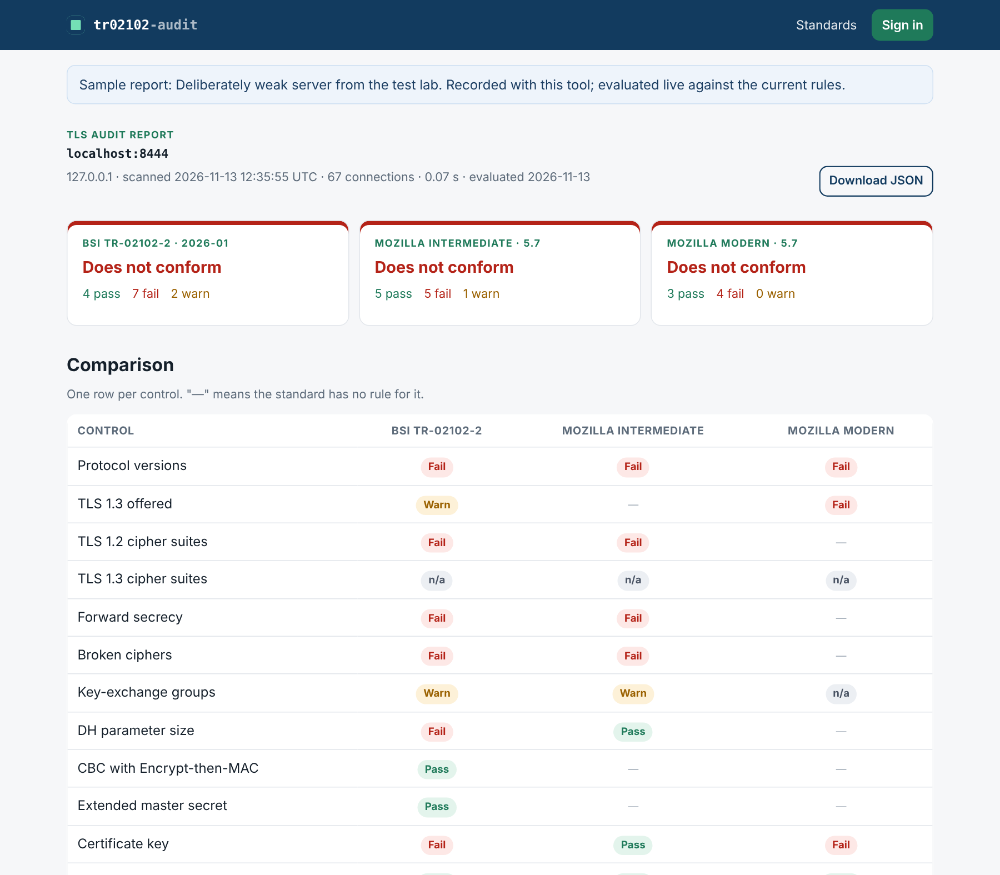
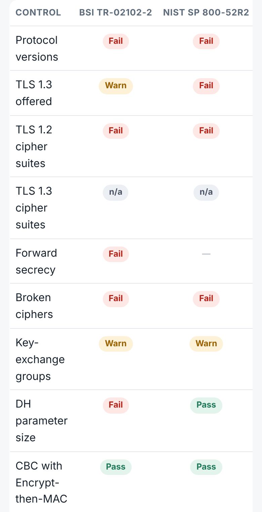
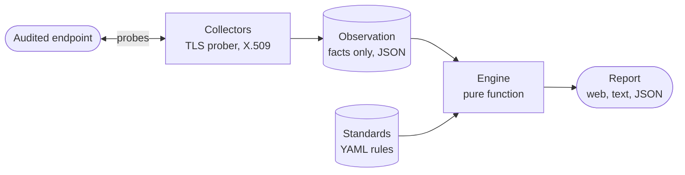

# tr02102-audit

[](https://github.com/maksymkisil2/tr02102-audit/actions/workflows/ci.yml)
[](https://github.com/maksymkisil2/tr02102-audit/actions/workflows/security.yml)


**Audit a server's TLS configuration against six national and international standards side by side (BSI TR-02102-2, NIST SP 800-52r2, IETF RFC 9325, NCSC-NL, Mozilla), from the command line or a web interface. Every finding cites the section it comes from.**

[](https://render.com/deploy?repo=https://github.com/maksymkisil2/tr02102-audit)



## The problem

[BSI TR-02102](https://www.bsi.bund.de/dok/TR-02102-en) is the German reference for which cryptographic mechanisms and key lengths to use, and under NIS2 it is the practical yardstick for the "state of the art" in Germany. Its tables change every year: the 2026-01 edition sets end dates for classical-only key agreement (end of 2031) and lists every cipher suite and group with a "use up to" year.

General-purpose TLS scanners show what a server accepts, but comparing that output with the guideline is manual work, has to be repeated after every revision, and ends in a spreadsheet nobody can reproduce. Different standards (BSI, Mozilla, NIST) also disagree in places, and nothing shows where.

## What the tool does

1. **Collects facts.** Hand-built TLS handshakes enumerate exactly which protocol versions, cipher suites and key-exchange groups the server accepts, plus the certificate, DH parameter size, Encrypt-then-MAC and extended master secret. No TLS library sits in between to hide anything.
2. **Evaluates them against standards.** Each standard is a YAML file of rules. One scan is judged against all of them at once.
3. **Shows where standards disagree.** The comparison matrix has one row per control and one column per standard.

| Standard | Region | Edition | Rules | Transcription |
|---|---|---|---|---|
| BSI TR-02102-2 (TLS) | Germany | 2026-01 | 16 | draft |
| NIST SP 800-52 Rev. 2 | USA | 2019-08 | 16 | verified |
| IETF RFC 9325 / BCP 195 | International | 2022-11 | 12 | verified |
| NCSC-NL TLS Security Guidelines | Netherlands | 2025-05 | 14 | draft |
| Mozilla Server Side TLS, Intermediate | International | 5.7 | 13 | draft |
| Mozilla Server Side TLS, Modern | International | 5.7 | 9 | draft |

The standards really do disagree, and the tool makes that visible:

| Configuration | BSI | NIST | IETF | NCSC-NL | Mozilla Int. |
|---|---|---|---|---|---|
| RSA 2048-bit certificate | fail | pass | pass | warn | pass |
| `TLS_CHACHA20_POLY1305_SHA256` | fail | fail (not FIPS) | — | pass | pass |
| `x25519` key exchange | warn | warn | — | pass | pass |
| Static ECDH key exchange | warn (until end of 2026) | pass | fail | fail | fail |

Adding a standard is adding a YAML file: see [docs/STANDARDS.md](docs/STANDARDS.md), which also lists the next candidates (BSI TR-03116-4, ANSSI, Canada ITSP.40.062, PCI DSS 4.0).

> **Transcription status.** NIST SP 800-52r2 and RFC 9325 were transcribed from the published text. The other rule sets stay *draft* until each rule has been checked line by line against the official document; details in [docs/STANDARDS.md](docs/STANDARDS.md#current-standards). The tool produces technical evidence for an audit, not a compliance certificate.

## Use it

### Web interface (any device)

Click **Deploy to Render** above. Render asks for one value, `APP_PASSWORD`; everything else is preconfigured in [`render.yaml`](render.yaml) (free plan, Frankfurt region, Docker). After a few minutes the service is at `https://tr02102-audit-….onrender.com`.

- Without signing in: start page, list of standards, and two sample reports.
- After signing in: scan any public server; the report shows verdicts per standard, the comparison matrix, what the server accepts, and each finding with evidence, reference and fix. Reports can be downloaded as JSON.

The free plan sleeps after inactivity, so the first request after a pause takes up to a minute.



### Command line

```bash
python -m pip install .

tr02102-audit scan example.org                  # all standards, text report
tr02102-audit scan example.org:8443 -s bsi-tr-02102-2 -f json -o report.json
tr02102-audit evaluate report.json -s mozilla-modern   # re-judge a stored scan, no network
tr02102-audit standards                          # list standards
tr02102-audit serve                              # web interface on 127.0.0.1:8080
```

Exit codes: `0` no failure at or above `--fail-on` (default `medium`), `1` failures found, `2` scan error or incomplete scan. A pipeline can therefore gate a deployment on the result.

### In a CI pipeline

`--format sarif` writes SARIF 2.1.0, the format CI dashboards read, so a weakened TLS configuration becomes an alert that opens and closes itself:

```bash
tr02102-audit scan "$HOST" --format sarif --output tls.sarif --fail-on high
```

Each finding carries its severity, the section of the standard it comes from, the fix, and a stable fingerprint, so the same finding stays the same alert across runs. A ready-to-copy weekly workflow that uploads the result to GitHub code scanning is in [`examples/`](examples/). The output is validated against the official SARIF schema in CI.

## How it works



- **Enumeration by elimination.** The prober offers all candidates, reads the server's choice from the cleartext ServerHello, removes it and repeats until the server refuses. For TLS 1.3 it sends an empty key share, so the server answers with a HelloRetryRequest that names its preferred group; no key exchange is needed.
- **Facts are separate from judgment.** Stored observations can be re-evaluated against a new edition of a standard without touching the server again.
- **Inconclusive is never "pass".** A timeout or reset is reported as unknown and fails the run.

Details: [docs/ARCHITECTURE.md](docs/ARCHITECTURE.md).

## Security of the tool itself

A hosted scanner parses data from servers it does not control and could be misused to probe other people's networks. The [threat model](docs/THREAT_MODEL.md) covers 19 threats with STRIDE; the most important ones:

| Threat | Response |
|---|---|
| Server-side request forgery: probing cloud metadata or internal networks through the web service | Every resolved address must be public; the IP is pinned for all probes, so DNS rebinding has no effect |
| Unauthorised scanning by strangers | Password login with rate limiting, an "I am authorised" confirmation per scan, 10 scans per hour |
| Script injection through certificate fields | All target data is escaped; the site uses no JavaScript and sends `Content-Security-Policy: default-src 'none'` |
| Hostile server stalls or floods the scanner | Timeouts, connection and time budget per scan, size limits on every record and message |
| A standard file is weakened or carries code | `yaml.safe_load`, strict schema validation, SHA-256 of each standard in every report, owner review via CODEOWNERS |

## Quality

- 85 tests, including end-to-end scans of real OpenSSL servers and tests for SSRF, CSRF, login rate limiting and open redirects.
- CI on every push: Ruff (with security rules), mypy in strict mode, pytest, SARIF output validated against the official schema, a Docker Compose lab whose servers are scanned by the CLI, and a container build that is started and probed.
- Weekly dependency audit; GitHub Actions pinned to commit hashes; read-only workflow token; Dependabot.
- The container runs as a non-root user.

## Development

```bash
python -m venv .venv && source .venv/bin/activate    # Windows: .venv\Scripts\activate
python -m pip install -r requirements.txt -e ".[dev]"
ruff check . && ruff format --check . && mypy && pytest

# web interface locally, without HTTPS
APP_PASSWORD=dev SESSION_COOKIE_SECURE=0 tr02102-audit serve

# lab: a modern and a deliberately weak TLS server on localhost
docker compose -f lab/docker-compose.yml run --rm smoke
tr02102-audit scan 127.0.0.1:8444
```

## Roadmap

| Milestone | Scope | Status |
|---|---|---|
| M0 | Repository, CI, test lab | Done |
| M1 | TLS prober, X.509 analysis, standards engine, CLI | Done |
| M1.5 | Several standards side by side, web interface, container, hosting | Done |
| M1.6 | International standards: NIST SP 800-52r2, IETF RFC 9325, NCSC-NL 2025-05 | Done |
| M2 | SARIF output, CI integration, first release | Done |
| M2.1 | Line-by-line verification of the BSI, NCSC-NL and Mozilla transcriptions | Next |
| M3 | SSH prober, BSI TR-02102-4 | Planned |
| M4 | strongSwan configuration parser, BSI TR-02102-3 | Planned |
| M5 | CycloneDX cryptographic bill of materials, post-quantum readiness | Planned |

## Related work

TLSAssistant, Greenbone/OpenVAS and BSI TaSK each cover part of this ground; how this project differs is described in [docs/ARCHITECTURE.md](docs/ARCHITECTURE.md#12-related-work).

## Contributing

Corrections to the transcribed standards are the most useful contribution; see [CONTRIBUTING.md](CONTRIBUTING.md). Released versions are listed in [CHANGELOG.md](CHANGELOG.md).

## Responsible use

For systems you own or are permitted to test. See [SECURITY.md](SECURITY.md) for reporting a vulnerability in the tool.

## Licence

[Apache-2.0](LICENSE)
