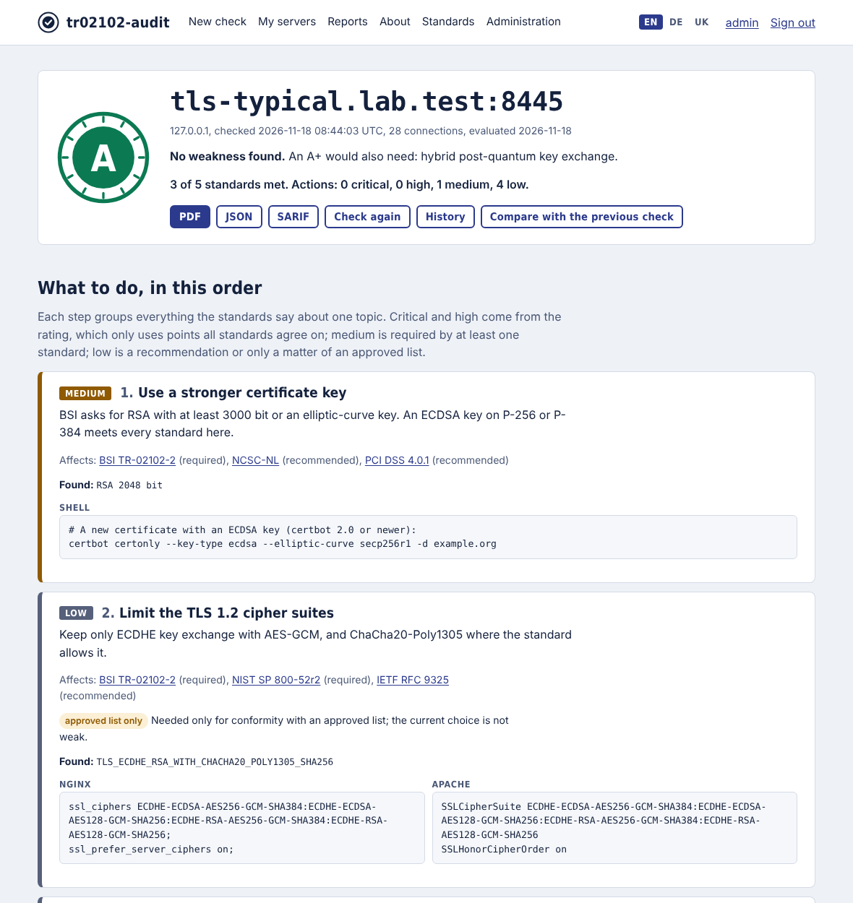
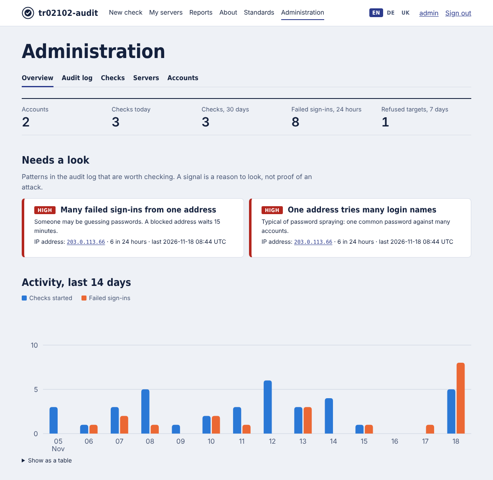
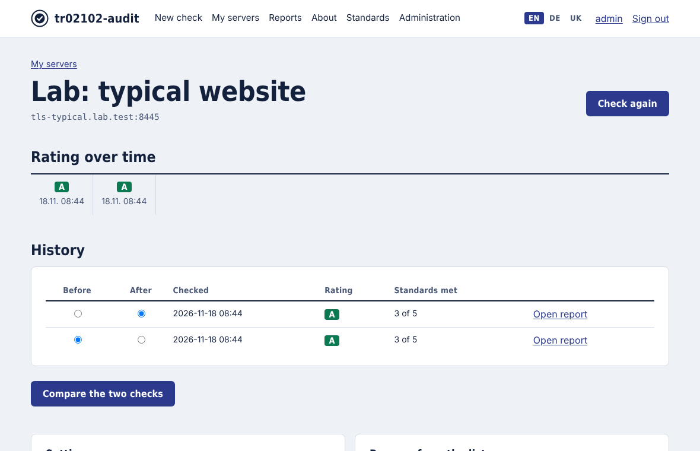
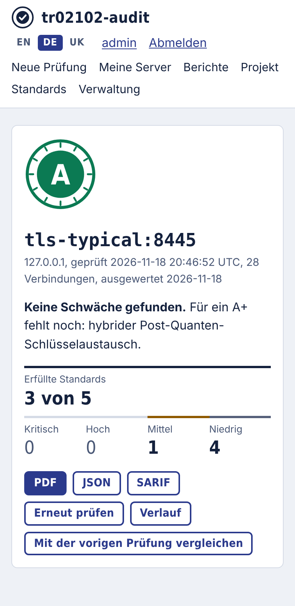
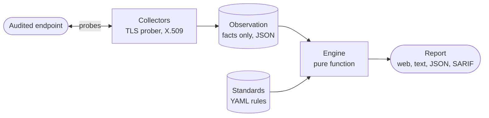

# tr02102-audit

[](https://github.com/maksymkisil2/tr02102-audit/actions/workflows/ci.yml)
[](https://github.com/maksymkisil2/tr02102-audit/actions/workflows/security.yml)


**Measure what a server's TLS configuration really accepts and compare it with BSI TR-02102-2, NIST SP 800-52r2, IETF RFC 9325, NCSC-NL and PCI DSS side by side. From a terminal, a CI pipeline or a hosted web interface with accounts and an audit log. Every finding cites the section it comes from.**

[](https://render.com/deploy?repo=https://github.com/maksymkisil2/tr02102-audit)



## The problem

[BSI TR-02102](https://www.bsi.bund.de/dok/TR-02102-en) is the German reference for which cryptographic mechanisms and key lengths to use, and under NIS2 it is the practical yardstick for the "state of the art" in Germany. NIST, the IETF, the Dutch NCSC and the payment card industry publish their own.

General-purpose TLS scanners show what a server accepts. Comparing that with a guideline is manual work, has to be repeated after every revision, and ends in a spreadsheet nobody can reproduce. The standards also disagree with each other, and nothing shows where.

There is a second problem: **"does not conform" is not the same as "insecure".** BSI TR-02102 and NIST SP 800-52 accept only the algorithms on their own approved lists. ChaCha20 and Curve25519, which most of the internet uses, are on neither list, so an ordinary well-run website fails both. A report that only says "fail" is useless to the person who has to act on it.

## What the tool does

1. **Measures.** Hand-built TLS handshakes enumerate which protocol versions, cipher suites and key-exchange groups the server accepts, plus the certificate, DH parameter size, Encrypt-then-MAC, extended master secret, secure renegotiation and compression. No TLS library sits in between to hide anything.
2. **Compares.** Each standard is a YAML file of rules. One measurement is judged against all of them. What a standard requires (MUST, shall) is a failure when missing; what it recommends (SHOULD) is a warning, exactly as the document words it.
3. **Rates.** A grade from A+ to F says how good the configuration is by common practice, using only points on which the standards agree. It is the tool's own summary and is labelled as such.
4. **Explains.** Every finding gives the reason, the evidence, the fix and the section of the standard. Failures that come only from an approved list are marked.
5. **Plans.** The report opens with an action plan: one step per topic, ranked by what matters most, with the nginx and Apache lines that make the change. The configuration comes from the project's lab, where CI checks it against the standards on every push.
6. **Compares.** Check a server again after a change and compare the two checks: what it accepts now, which findings are fixed, which are new.

| Standard | Kind | Edition | Rules | Transcription |
|---|---|---|---|---|
| BSI TR-02102-2 (TLS) | Government, Germany | 2026-01 | 18 | draft |
| NIST SP 800-52 Rev. 2 | Government, USA | 2019-08 | 18 | verified |
| NCSC-NL TLS Security Guidelines | Government, Netherlands | 2025-05 | 15 | draft |
| IETF RFC 9325 / BCP 195 | International | 2022-11 | 16 | verified |
| PCI DSS v4.0.1, requirement 4.2.1 | International, payment cards | 2024-06 | 10 | verified |
| Mozilla Server Side TLS, Intermediate and Modern | Community advice, optional | 5.7 | 13 and 9 | draft |

The three servers of the project's test lab show how the two answers differ:

| Server | Rating | BSI | NIST | IETF | NCSC-NL | PCI DSS |
|---|---|---|---|---|---|---|
| Deliberately weak (TLS 1.0 and 1.1, anonymous and static-RSA key exchange, no TLS 1.3) | F | fail | fail | fail | fail | fail |
| Typical modern website (ECDHE, AES-GCM and ChaCha20, X25519, RSA 2048) | A | fail | fail, approved list only | conforms, 1 warning | conforms, 2 warnings | conforms, 2 warnings |
| Hardened to the BSI lists (AES-GCM only, NIST curves, ECDSA certificate) | A | conforms, 1 warning | conforms | conforms | conforms, 1 warning | conforms, 1 warning |

The remaining warnings on the hardened server are the same one three times: no hybrid post-quantum key exchange yet. That is also what separates an A from an A+.

Adding a standard is adding a YAML file: see [docs/STANDARDS.md](docs/STANDARDS.md).

> **Transcription status.** NIST SP 800-52r2, RFC 9325 and PCI DSS 4.2.1 were transcribed from the published text. The other rule sets stay *draft* until each rule has been checked line by line against the official document; details in [docs/STANDARDS.md](docs/STANDARDS.md#current-standards).

### Certificates and regulations

ISO/IEC 27001, PCI DSS or SOC 2 certificates are issued by accredited auditors after assessing a whole organisation. No scanner can award them. What an auditor asks for is evidence that encryption in transit follows a recognised technical standard, and a report from this tool is that evidence. The standards page of the web interface maps a report to the clauses that ask for it:

| Framework | Clause |
|---|---|
| ISO/IEC 27001:2022 | Annex A 8.24, 8.20, 8.21, 5.14 |
| PCI DSS v4.0.1 | Req. 4.2.1, 12.3.3 |
| NIS2 Directive (EU) 2022/2555 | Art. 21(2)(h); Germany: § 30 (2) no. 8 BSIG |
| DORA (EU) 2022/2554 | Art. 9; RTS (EU) 2024/1774 Art. 6, 7, 14 |
| GDPR | Art. 32(1)(a) |
| BSI C5:2020, BSI IT-Grundschutz, SOC 2, HIPAA, CIS Controls v8, NIST CSF 2.0 | see the standards page |

## Use it

### Web interface

Click **Deploy to Render** above. Render asks for `APP_PASSWORD`, which becomes the password of the first administrator (login name `admin`). Everything else is preconfigured in [`render.yaml`](render.yaml): free plan, Frankfurt region, Docker.

- **Without an account:** start page, what the project is about, the standards with all their rules, three sample reports.
- **With an account:** check any public server and choose the report format first: web page, PDF, JSON or SARIF. Every report is kept and can be downloaded in all four formats later.
- **My servers.** Keep a server in a list, check it again with one click, see its rating over time, and compare any two checks.
- **Accounts and roles.** Registration is closed until an administrator opens it; until then the administrator creates accounts. Every account has a monthly limit of checks (default 50, adjustable per account) and an hourly limit of 30.
- **Administration.** Who signed in, who failed to, who checked which address, with time, IP address, country and browser; activity per day; accounts can be limited, blocked or deleted. The audit log filters by kind, address, account and date and exports to CSV. The overview flags patterns worth a look, such as password guessing from one address, one address trying many login names, or an account that probes private addresses; the rules are listed in [`web/signals.py`](src/tr02102_audit/web/signals.py). It also shows whether the database is reachable and which schema version it has.
- **Languages.** English, German and Ukrainian. The choice follows the link in the header, then the account, then the browser.







**Keeping data.** Accounts, reports and the audit log live in a database. By default that is an SQLite file under `DATA_DIR`. A free Render service has no persistent disk, so the file is lost on every restart; the administration page says so. Set `DATABASE_URL` to a PostgreSQL database to keep the data. Render's own free PostgreSQL [expires after 30 days](https://render.com/docs/free); a permanent free tier such as [Neon](https://neon.com/docs/introduction/plans) (1 GB per project, the database sleeps after 5 minutes without queries) is enough for one instance. The service reconnects by itself when such a database wakes up, and new versions upgrade the schema on start-up.

| Variable | Meaning | Default |
|---|---|---|
| `APP_PASSWORD` | Password of the first administrator, created at start-up. Without it the site only shows the samples. | none |
| `ADMIN_LOGIN` | Login name of that administrator | `admin` |
| `ADMIN_RESET` | `1` sets the administrator's password to `APP_PASSWORD` again (lost password) | off |
| `SECRET_KEY` | Signs the session cookie; a long random value | random per start |
| `DATABASE_URL` | `postgresql://…` for PostgreSQL | SQLite file |
| `DATA_DIR` | Directory of the SQLite file | `data` (`/data` in the image) |
| `CHECKS_PER_MONTH` | Monthly limit of an account, unless an administrator sets another one | `50` |
| `AUDIT_RETENTION_DAYS`, `REPORT_RETENTION_DAYS` | How long audit events and reports are kept | `30`, `365` |
| `OPERATOR_NAME`, `OPERATOR_ADDRESS`, `OPERATOR_EMAIL` | Who runs the instance; shown in the imprint and the privacy notice | none |
| `PRIVATE_NETWORKS` | Private networks that may be checked anyway, for a lab: `172.30.80.0/24, 192.168.1.0/24`. Every other private address stays refused. | none |
| `CA_FILE` | Extra trusted certificate authorities (PEM file), for a lab or a company PKI | none |
| `TRUST_PROXY`, `CLIENT_IP_HEADER` | Behind a reverse proxy: trust its headers, and which header carries the visitor's address. The image sets `TRUST_PROXY=1`; on Render the header is detected. | off |

The legal pages (imprint, privacy, terms of use) describe what the software stores and does. Whoever runs a public instance has to review and complete them; they are not legal advice.

### On your own computer: the lab

The lab starts the web interface together with test servers on a laptop with Docker, so you can configure a server yourself and watch each change in the report:

```bash
docker compose -f lab/docker-compose.yml up -d --build
# open http://127.0.0.1:8080, sign in as admin / lab-admin-password, check "my-site"
```

`my-site` starts with nginx's default TLS settings; its configuration file lists exercises from rating A to full BSI conformity. Details: [lab/README.md](lab/README.md).

### Command line

```bash
python -m pip install .

tr02102-audit scan example.org                  # the five formal standards, text report
tr02102-audit scan example.org:8443 -s bsi-tr-02102-2 -f json -o report.json
tr02102-audit scan example.org -f pdf -o report.pdf               # PDF with the action plan
tr02102-audit scan intranet.example --ca-file company-ca.pem    # internal PKI
tr02102-audit evaluate report.json -s all        # re-judge a stored scan, no network
tr02102-audit standards                          # list standards
tr02102-audit serve                              # web interface on 127.0.0.1:8080
```

Exit codes: `0` no failure at or above `--fail-on` (default `medium`), `1` failures found, `2` scan error or incomplete scan. A pipeline can therefore gate a deployment on the result.

### In a CI pipeline

`--format sarif` writes SARIF 2.1.0, the format CI dashboards read, so a weakened TLS configuration becomes an alert that opens and closes itself:

```bash
tr02102-audit scan "$HOST" --format sarif --output tls.sarif --fail-on high
```

Each finding carries its severity, the section of the standard it comes from, the fix, and a stable fingerprint, so the same finding stays the same alert across runs. A ready-to-copy weekly workflow that uploads the result to GitHub code scanning is in [`examples/`](examples/). The output is validated against the official SARIF schema in CI.

## How it works



- **Enumeration by elimination.** The prober offers all candidates, reads the server's choice from the cleartext ServerHello, removes it and repeats until the server refuses. For TLS 1.3 it sends an empty key share, so the server answers with a HelloRetryRequest that names its preferred group; no key exchange is needed.
- **Facts are separate from judgment.** Stored observations can be re-evaluated against a new edition of a standard without touching the server again.
- **Unknown is never "pass".** Unanswered probes are repeated; after each enumeration a control probe checks that the server still answers. What stays unmeasured is reported as unknown, the report is marked incomplete, and no rating is given.
- **Checked against an independent implementation.** A [validation workflow](.github/workflows/validation.yml) scans 18 public servers and compares every fact with what OpenSSL negotiates with the same server ([`validation/`](validation/)).

Details: [docs/ARCHITECTURE.md](docs/ARCHITECTURE.md).

## Security of the tool itself

A hosted scanner parses data from servers it does not control, holds accounts, and could be misused to probe other people's networks. The [threat model](docs/THREAT_MODEL.md) covers 28 threats with STRIDE; the most important ones:

| Threat | Response |
|---|---|
| Server-side request forgery: probing cloud metadata or internal networks through the web service | Every resolved address must be public; the IP is pinned for all probes, so DNS rebinding has no effect. Refused targets are written to the audit log. |
| Scanning by strangers | Accounts only, registration closed by default, an "I am authorised" confirmation per check, limits per hour and month, an audit log of who checked what from where |
| Password guessing and stolen sessions | scrypt password hashes, the same answer and timing for unknown logins, 10 failed attempts per address and 100 per login name in 15 minutes, a new session at sign-in, all sessions end when the password changes |
| One user reads another's reports | Reports belong to an account; a foreign report answers exactly like one that does not exist |
| Script injection through certificate fields or logged text | All output is escaped; the site uses no JavaScript and sends `Content-Security-Policy: default-src 'none'` |
| SQL injection | Bound parameters only; column names never come from a request |
| Hostile server stalls or floods the scanner | Timeouts, connection and time budget per scan, size limits on every record and message |
| A standard file is weakened or carries code | `yaml.safe_load`, strict schema validation, SHA-256 of each standard in every report, owner review via CODEOWNERS |

## Quality

- 223 tests: end-to-end scans of real OpenSSL servers, hostile input for every parser, the web interface (roles, CSRF, SSRF, limits, session handling, languages), schema upgrades, PDF output and the action plan, whose cipher lists are checked against OpenSSL.
- In CI the lab's web interface is built from the commit and used end to end, the way a person would: sign in, check, download a PDF, check again, compare.
- The storage and web tests run on SQLite and again on PostgreSQL in CI.
- CI on every push: Ruff (with security rules), mypy in strict mode, pytest, SARIF output validated against the official schema, a Docker Compose lab whose servers are scanned by the CLI, and a container build that is started and signed in to.
- Weekly dependency audit; GitHub Actions pinned to commit hashes; read-only workflow token; Dependabot.
- The container runs as a non-root user.

## Development

```bash
python -m venv .venv && source .venv/bin/activate    # Windows: .venv\Scripts\activate
python -m pip install -r requirements.txt -e ".[dev]"
ruff check . && ruff format --check . && mypy && pytest

# web interface locally; sign in as "admin"
APP_PASSWORD='a long passphrase' tr02102-audit serve

# lab: three TLS servers with known configurations on localhost
docker compose -f lab/docker-compose.yml run --rm smoke
tr02102-audit scan 127.0.0.1:8444
```

Interface texts live in `src/tr02102_audit/web/locale/<language>.json`. A test fails when a text has no translation or a translation is no longer used.

## Roadmap

| Milestone | Scope | Status |
|---|---|---|
| M0 | Repository, CI, test lab | Done |
| M1 | TLS prober, X.509 analysis, standards engine, CLI | Done |
| M1.5 | Several standards side by side, web interface, container, hosting | Done |
| M1.6 | International standards: NIST SP 800-52r2, IETF RFC 9325, NCSC-NL 2025-05 | Done |
| M2 | SARIF output, CI integration, first release | Done |
| M2.2 | Requirement levels, rating, PCI DSS, validation against OpenSSL; accounts, administration with audit log, three languages | Done |
| M2.3 | Action plan with server configuration, PDF reports, saved servers with before/after comparison, audit-log filters, CSV export and signals, the lab on a laptop | Done |
| M2.1 | Line-by-line verification of the BSI, NCSC-NL and Mozilla transcriptions | Next |
| M3 | SSH prober, BSI TR-02102-4 | Planned |
| M4 | strongSwan configuration parser, BSI TR-02102-3 | Planned |
| M5 | CycloneDX cryptographic bill of materials, post-quantum readiness | Planned |

## Related work

TLSAssistant, Greenbone/OpenVAS and BSI TaSK each cover part of this ground; how this project differs is described in [docs/ARCHITECTURE.md](docs/ARCHITECTURE.md#12-related-work).

## Contributing

Corrections to the transcribed standards are the most useful contribution; see [CONTRIBUTING.md](CONTRIBUTING.md). Released versions are listed in [CHANGELOG.md](CHANGELOG.md).

## Responsible use

For systems you own or are permitted to test. See [SECURITY.md](SECURITY.md) for reporting a vulnerability in the tool.

## Licence

[Apache-2.0](LICENSE)
