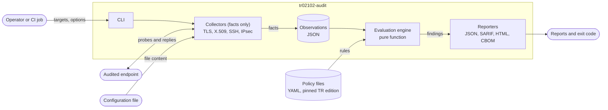

# tr02102-audit

[](https://github.com/maksymkisil2/tr02102-audit/actions/workflows/ci.yml)
[](https://github.com/maksymkisil2/tr02102-audit/actions/workflows/security.yml)


**Check the cryptographic configuration of TLS, SSH and IPsec services against [BSI TR-02102](https://www.bsi.bund.de/dok/TR-02102-en), with every finding traced to the section of the guideline it comes from.**

> **Project status: milestone M0, foundation.** The repository, CI pipeline and test lab are in place. The scanner itself is built in M1, so nothing here audits a server yet. See the [roadmap](#roadmap).

## The problem

BSI TR-02102 is the German reference for which cryptographic mechanisms and key lengths to use. It has four parts: general recommendations, TLS, IPsec and SSH. It is revised regularly, and the 2026-01 edition sets end dates for the classical-only use of key agreement (end of 2031) and of signatures (end of 2035).

Without dedicated tooling, checking a service against it means running a general-purpose scanner and comparing the output with the guideline by hand, then doing it again after the next revision. The result is hard to reproduce and hard to show to an auditor.

## The approach

`tr02102-audit` connects to the endpoints you name, records which cryptographic parameters they actually accept, and evaluates those facts against a versioned, machine-readable transcription of the guideline.



Three decisions shape the design:

1. **Facts are separate from judgment.** Collectors only record what an endpoint does. A separate engine decides whether that is acceptable. Stored facts can be re-evaluated later without touching the server again.
2. **The guideline is data, not code.** Each edition of TR-02102 is a set of YAML files in which every rule cites its section. Supporting a new edition means adding files.
3. **Inconclusive is never "pass".** A timeout or a dropped connection is reported as inconclusive and fails the run. A network problem cannot turn into a clean audit result.

Details: [docs/ARCHITECTURE.md](docs/ARCHITECTURE.md).

## Planned scope

| Area | Guideline part | Milestone |
|---|---|---|
| TLS protocol versions, cipher suites, key-exchange groups | TR-02102-2 | M1 |
| X.509 key sizes and signature algorithms | TR-02102-1, TR-02102-2 | M1 |
| SARIF and HTML reports, GitHub code scanning integration | – | M2 |
| SSH key exchange, host keys, ciphers, MACs | TR-02102-4 | M3 |
| IPsec / IKEv2 proposals from strongSwan configuration | TR-02102-3 | M4 |
| Cryptographic bill of materials (CycloneDX), post-quantum readiness | TR-02102-1 | M5 |

Out of scope: exploitation, implementation-bug checks, host or port discovery, and any claim of formal compliance.

## Security of the tool itself

An audit tool parses data from servers it does not control, and people act on its reports. The project therefore starts from a [STRIDE threat model](docs/THREAT_MODEL.md): 13 threats, each with a mitigation and the test that will verify it. Three examples:

| Threat | Response |
|---|---|
| A certificate field or SSH banner carries script or terminal escape sequences into a report | Every value that came from a target is treated as tainted and encoded for the output format |
| A policy file is quietly weakened, so a weak server passes | The policy edition and its SHA-256 are embedded in every report; policy changes require owner review |
| A hostile server stalls or floods the scanner | Timeouts, a per-target deadline and hard size limits on everything read from the network |

## What exists today

| Path | Content |
|---|---|
| [`docs/ARCHITECTURE.md`](docs/ARCHITECTURE.md) | Components, data model, scan sequence, how TLS probing works |
| [`docs/THREAT_MODEL.md`](docs/THREAT_MODEL.md) | Assets, trust boundaries, STRIDE analysis, residual risks |
| [`docs/adr/`](docs/adr/) | Architecture decision records |
| [`lab/`](lab/) | Two TLS servers with known configurations, one modern and one deliberately weak, plus a smoke test |
| [`src/tr02102_audit/`](src/tr02102_audit/) | Package skeleton: command-line entry point and the exit-code contract |
| [`.github/workflows/`](.github/workflows/) | CI (lint, strict typing, tests, lab smoke test) and a weekly dependency audit |

## Try the lab

Requires Docker with Compose v2.

```bash
# start a modern and a deliberately weak TLS server on localhost
docker compose -f lab/docker-compose.yml up -d

# verify that both behave as documented
docker compose -f lab/docker-compose.yml run --rm smoke

# stop and delete the generated certificates
docker compose -f lab/docker-compose.yml down -v
```

What is deliberately wrong with the weak server is listed in [lab/README.md](lab/README.md).

## Development

Requires Python 3.13.

```bash
python -m venv .venv
source .venv/bin/activate        # Windows: .venv\Scripts\activate
python -m pip install -e ".[dev]"

ruff check .            # lint, including security rules
ruff format --check .   # formatting
mypy                    # strict type-checking
pytest                  # tests
```

CI runs the same four commands on every push and pull request. GitHub Actions are pinned to commit hashes and the workflow token is read-only.

## Roadmap

| Milestone | Scope | Status |
|---|---|---|
| M0 | Repository skeleton, CI, lab with two TLS targets | In progress |
| M1 | TLS prober, X.509 analyser, TR-02102-2 policy, JSON report | Next |
| M2 | SARIF and HTML reports, example CI integration, container image | Planned |
| M3 | SSH prober, TR-02102-4 policy | Planned |
| M4 | strongSwan configuration parser, TR-02102-3 policy | Planned |
| M5 | CycloneDX CBOM, post-quantum readiness section | Planned |

Each milestone has a "done when" criterion in [docs/ARCHITECTURE.md](docs/ARCHITECTURE.md#10-milestones).

## Related work

The niche is not empty: TLSAssistant, Greenbone/OpenVAS and BSI TaSK each cover part of this ground. How this project differs is described in [docs/ARCHITECTURE.md](docs/ARCHITECTURE.md#11-related-work).

## Responsible use

For auditing systems you own or are permitted to test. See [SECURITY.md](SECURITY.md) for how to report a vulnerability in the tool.

## Licence

[Apache-2.0](LICENSE)
