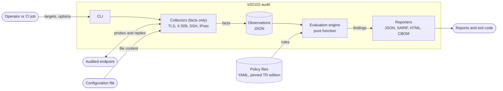
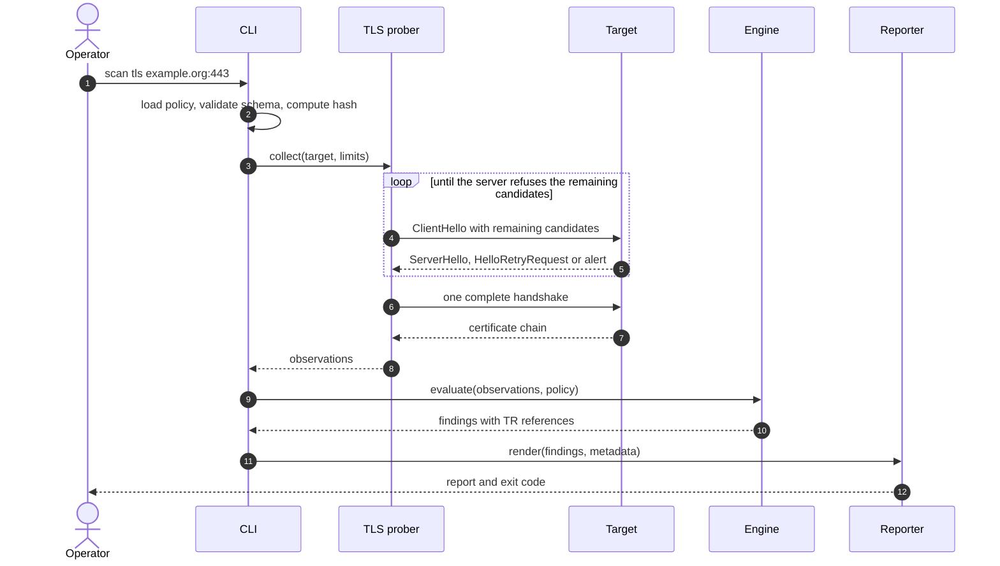
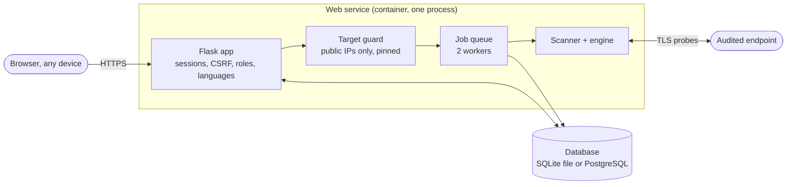

# Architecture

> Status: living document · Implemented: M0, M1, M1.5, M1.6, M2, M2.2 · Last updated: 2026-11-16

## 1. Purpose

`tr02102-audit` checks whether the cryptographic configuration of network services follows BSI Technical Guideline TR-02102, "Cryptographic Mechanisms: Recommendations and Key Lengths".

For each audited endpoint it answers one question: which cryptographic parameters does this service actually accept, and which of them fall outside what the pinned TR-02102 edition recommends?

The same measurement is judged against other published standards as well (NIST SP 800-52r2, IETF RFC 9325, NCSC-NL, PCI DSS 4.2.1), because they disagree in instructive ways and because an auditor outside Germany asks for a different one. TR-02102 stays the reference the project is named after.

| Collector | What it inspects | Evaluated against | Milestone |
|---|---|---|---|
| TLS prober | Protocol versions, cipher suites, key-exchange groups | TR-02102-2 | M1 |
| X.509 analyser | Key type and size, signature algorithm, validity | TR-02102-1, TR-02102-2 | M1 |
| SSH prober | Key exchange, host keys, ciphers, MACs | TR-02102-4 | M3 |
| IPsec config parser | IKEv2 and ESP proposals in strongSwan configuration | TR-02102-3 | M4 |

### Non-goals

- No exploitation and no implementation-bug checks (Heartbleed, ROBOT and similar). General-purpose scanners cover those.
- No host or port discovery. The tool audits only the endpoints the operator names.
- No statement of formal compliance. The output is technical evidence for an auditor, not a certificate.

## 2. Design principles

| ID | Principle | Consequence in the design |
|---|---|---|
| P1 | Every finding is traceable | Each rule carries the TR part, edition and section it was transcribed from. |
| P2 | Facts are separate from judgment | Collectors record what an endpoint does. Only the engine decides whether that is acceptable. |
| P3 | Policy is data, not code | A TR edition is a set of declarative YAML files. Supporting a new edition means adding files, not changing code. |
| P4 | Results are reproducible | The engine is a pure function. Stored observations can be re-evaluated offline against any edition. |
| P5 | Inconclusive is never "pass" | Every check ends as `pass`, `fail`, `warn` or `inconclusive`. Network errors never turn into a clean result. |
| P6 | Safe by default | Bounded, low-rate traffic. All data received from a target is treated as hostile input. |
| P7 | Built for automation | Stable exit codes and machine-readable reports (JSON, SARIF) so the tool can gate a CI pipeline. |

## 3. Component view



The X.509 analyser does not open its own connection: it receives the certificate chain that the TLS prober fetched.

| Component | Responsibility | Must not do |
|---|---|---|
| CLI | Parse arguments, load and validate the policy, orchestrate a scan, set the exit code | Contain protocol or policy logic |
| Collectors | Talk to one protocol or parse one file format and emit normalised observations | Judge whether a value is good or bad |
| Observation store | Persist observations as JSON so a scan can be re-evaluated later | Hold findings |
| Policy loader | Load YAML with a safe loader, validate it against a JSON Schema, compute its SHA-256 | Execute anything found in a policy file |
| Evaluation engine | Map observations and rules to findings | Perform I/O or network access |
| Reporters | Render findings; escape every value that originated from a target | Change a finding |

## 4. Data model

Three record types flow through the tool. Field names below are the contract between components.

**Observation** – facts, with no verdict attached (abridged):

```json
{
  "format": 2,
  "tool_version": "0.2.0",
  "collector": "tls",
  "collected_at": "2026-11-15T21:06:31+00:00",
  "connections": 28,
  "target": { "host": "example.org", "port": 443, "ip": "203.0.113.10", "sni": "example.org" },
  "complete": true,
  "incomplete": [],
  "facts": {
    "tls": {
      "protocol_versions": ["TLS1.2", "TLS1.3"],
      "version_probes": { "SSL3.0": "refused", "TLS1.0": "refused", "TLS1.2": "accepted", "TLS1.3": "accepted" },
      "suites": { "tls13": ["TLS_AES_256_GCM_SHA384"], "tls12": ["TLS_ECDHE_RSA_WITH_AES_128_GCM_SHA256"] },
      "groups": { "tls13": ["x25519", "secp256r1"], "tls12": ["secp256r1"] },
      "extended_master_secret": true,
      "secure_renegotiation": true,
      "compression": false
    },
    "certificate": { "key_type": "RSA", "key_bits": 2048, "signature_hash": "sha256", "trusted": true }
  }
}
```

`complete` is false when something could not be measured; `incomplete` then says what. A fact that is unknown is `null`, never a guess.

**Rule** – one recommendation from a standard, as data. The full format, the operators and the procedure for adding a standard are in [STANDARDS.md](STANDARDS.md).

```yaml
- id: BSI-TLS-01
  control: protocol-versions
  title: Only TLS 1.2 and TLS 1.3 are offered
  severity: high
  reference: "TR-02102-2, sec. 3.2"
  check:
    subject: tls.protocol_versions
    op: subset_of
    values: [TLS1.2, TLS1.3]
```

There is no expression language and no templating in standard files.

**Finding** – the result of applying one rule to one observation:

```json
{
  "rule_id": "BSI-TLS-06",
  "control": "tls13-cipher-suites",
  "title": "TLS 1.3 cipher suites are recommended ones",
  "level": "required",
  "severity": "high",
  "status": "fail",
  "message": "not covered by the recommendation",
  "evidence": ["TLS_CHACHA20_POLY1305_SHA256"],
  "reference": "TR-02102-2, sec. 3.4, Table 13",
  "remediation": "Offer only TLS_AES_256_GCM_SHA384, TLS_AES_128_GCM_SHA256 ...",
  "off_list_only": true
}
```

`level` is what the standard says: `required` (MUST, shall) or `recommended` (SHOULD). A violated requirement is a `fail`, a violated recommendation a `warn`. `off_list_only` marks a finding whose only cause is that a sound value (an AEAD cipher suite with forward secrecy, a known key-exchange group) is missing from the standard's approved list.

**Verdict and rating.** Per standard the findings add up to a verdict: `pass`, `pass_with_warnings`, `fail`, or `incomplete` when something this standard has a rule for could not be measured. Separately, the report carries a rating from A+ to F ([`rating.yaml`](../src/tr02102_audit/rating.yaml)): the tool's own summary of how good the configuration is by common practice, built only from points on which the standards agree and evaluated by the same engine. An incomplete measurement is not rated. The two answers are kept apart on purpose, because a typical well-run website conforms to RFC 9325 and PCI DSS and still fails the approved lists of BSI and NIST.

## 5. Scan sequence (TLS)



## 6. How TLS probing works

The prober builds ClientHello messages itself instead of relying on a TLS library, because a library only offers what its own build supports and hides what the server would have accepted.

- **Enumeration by elimination.** For each protocol version the prober offers all remaining candidate cipher suites. The server picks one; the prober records it, removes it from the list and repeats until the server refuses. The same method enumerates key-exchange groups. The number of connections is about the number of supported values plus one.
- **No cryptography needed for enumeration.** The server's choice arrives in ServerHello (or HelloRetryRequest), which is sent in cleartext in every TLS version. The prober reads that reply and closes the connection.
- **Key-exchange details in TLS 1.2** (curve, DH group size) are read from ServerKeyExchange, also cleartext.
- **Certificates.** TLS 1.3 encrypts the Certificate message, so the chain is fetched with one complete handshake through the standard library, with validation disabled on purpose: the collector retrieves, the engine judges.
- **Three outcomes per probe:** accepted, refused (clean alert), or inconclusive (timeout, reset, malformed reply). Inconclusive probes are listed in the observation and surface in the report (P5).
- **Post-quantum readiness.** The prober also reports whether the endpoint accepts a hybrid key-exchange group such as X25519MLKEM768. This is shown as a separate, informational section and is not mixed into the conformance verdict.

## 7. Outputs and exit codes

| Format | Consumer |
|---|---|
| JSON | Scripts, archival, later re-evaluation |
| Text | Terminal |
| SARIF 2.1.0 | GitHub code scanning and other CI dashboards; validated against the official schema in CI |
| HTML | The report page of the web interface; no scripts, with a print stylesheet for "save as PDF" |
| CycloneDX CBOM | Cryptographic inventory (M5) |

Every report embeds: tool version, policy edition and SHA-256, UTC timestamp, target, resolved IP, and the options used.

| Exit code | Meaning |
|---|---|
| 0 | No finding at or above the configured severity threshold |
| 1 | At least one finding at or above the threshold |
| 2 | Scan error or inconclusive result; the outcome must not be read as "pass" |

## 8. Technology choices

| Concern | Choice | Reason |
|---|---|---|
| Language | Python 3.13 | Memory-safe, strong typing support, mature security libraries. See [ADR-0001](adr/0001-python-as-implementation-language.md). |
| TLS probing | Own ClientHello builder and parser (standard library only) | A TLS library would hide what the server accepts (section 6) |
| X.509 parsing | `cryptography` | Maintained, memory-safe parser |
| Standards | YAML via `yaml.safe_load`, strict validation in `standards/__init__.py` | Readable in review, cannot carry code (T-12); see [STANDARDS.md](STANDARDS.md) |
| Models | Standard-library dataclasses | Enough for the current size; no extra dependency |
| CLI | `argparse` | No extra dependency |
| Web interface | Flask + Jinja2 (autoescape), served by gunicorn | Small, well known, output encoding by default (T-13) |
| Storage | SQLite from the standard library; PostgreSQL through `psycopg` when `DATABASE_URL` is set | No server to run for a single instance; a real database where the disk is not persistent. One small SQL subset for both, bound parameters only (T-20). |
| Passwords | `hashlib.scrypt` from the standard library | A memory-hard function without an extra dependency (T-15, T-23) |
| Interface languages | Own JSON catalogs, English text as the message id | Three languages do not justify a gettext toolchain; a test keeps the catalogs complete |
| Tests | pytest; end-to-end scans of OpenSSL `s_server`; Docker Compose lab in CI | Facts and verdicts are checked against servers with a known configuration |
| Quality gates | Ruff (including its bandit rules), mypy in strict mode, pip-audit | Lint, types and dependency audit in CI |
| Supply chain | Actions pinned by commit hash, read-only workflow token, Dependabot, exact versions in `requirements.txt` | Small supply-chain surface (T-04). Hash-locking is still open. |
| Delivery | Container image (non-root), Render Blueprint (`render.yaml`) | Reproducible run, one-click hosting |

## 9. Web interface and deployment



- **Same code as the CLI.** The web layer adds accounts, the target guard, a job queue and storage. Scanning and judging are the functions the CLI calls.
- **No JavaScript.** Scans run in the background; the report page refreshes itself until the job is done. The Content-Security-Policy stays at `default-src 'none'`. The activity chart in the administration is server-rendered SVG.
- **Accounts and roles.** Two roles, user and administrator. The first administrator is created at start-up from `APP_PASSWORD`; without it the instance only shows the sample reports. Registration is a setting an administrator switches on; until then accounts are created by hand.
- **What is stored.** Four tables: `users`, `scans` (the observation as JSON plus grade and verdicts, so a report can be rebuilt with the current rules), `events` (the audit log) and `settings`. Reports and audit events are deleted after their retention time.
- **Audit log.** Sign-ins, failed sign-ins, registrations, checks started, refused and finished, and administrative changes, each with time, account, IP address, country and browser. Behind a proxy the visitor's address is read from the header the operator names (`CLIENT_IP_HEADER`; on Render `CF-Connecting-IP`), never from a header the client can simply send (T-26).
- **Limits.** Per account: checks per month (in the database) and per hour (in memory). Per address: failed sign-ins and registrations.
- **Languages.** English, German, Ukrainian. Templates and messages pass through one function; the English text is the key, so a missing translation shows English instead of a placeholder. Rule texts are quoted from the standards and stay in English.
- **One process.** Jobs and the in-memory limits assume a single process (gunicorn with one worker and threads). Scaling out would need a shared queue and counter.
- **Deployment.** A container image that runs as a non-root user and keeps its SQLite file under `/data`, and a Render Blueprint. On hosting without a persistent disk, `DATABASE_URL` points the service at PostgreSQL; the administration page warns when data would not survive a restart.

Configuration is by environment variables, listed in the README and in `web/__init__.py`.

## 10. Repository layout

```text
tr02102-audit/
├── src/tr02102_audit/
│   ├── cli.py               # scan, evaluate, standards, serve
│   ├── netguard.py          # target parsing, resolution, SSRF guard
│   ├── scan.py              # runs collectors, builds the observation
│   ├── tls/                 # registry.py, wire.py (ClientHello/parsers), prober.py
│   ├── x509.py              # certificate facts
│   ├── engine.py            # rules + facts -> findings (pure)
│   ├── rating.py, rating.yaml   # overall grade A+ to F
│   ├── report.py            # report assembly, comparison, text output
│   ├── sarif.py             # SARIF 2.1.0 output for CI dashboards
│   ├── standards/           # one YAML file per standard + loader
│   └── web/
│       ├── __init__.py      # application factory, configuration, headers
│       ├── store.py         # SQLite / PostgreSQL
│       ├── security.py      # passwords, rate limits, visitor address
│       ├── quota.py         # limits per account
│       ├── i18n.py, locale/ # interface languages
│       ├── views_*.py       # public pages, account pages, administration
│       └── templates/, static/, demo/
├── examples/                # ready-to-copy CI workflow
├── lab/                     # docker-compose.yml: three TLS servers with known configurations
├── validation/              # cross-check of the scanner against OpenSSL on public servers
├── tests/                   # unit, web and end-to-end tests
├── docs/                    # ARCHITECTURE.md, THREAT_MODEL.md, STANDARDS.md, adr/
├── Dockerfile, render.yaml  # container image and hosting
└── .github/workflows/
```

## 11. Milestones

| Milestone | Scope | Status |
|---|---|---|
| M0 | Repository skeleton, CI, lab with two TLS targets | Done |
| M1 | TLS prober, X.509 analyser, standards engine, JSON and text reports | Done |
| M1.5 | Several standards side by side (BSI TR-02102-2, Mozilla Intermediate and Modern), web interface, container image, hosting | Done |
| M1.6 | International standards (NIST SP 800-52r2, IETF RFC 9325, NCSC-NL 2025-05); phase-out levels in rules | Done |
| M2 | SARIF 2.1.0 output, CI integration example, first release | Done |
| M2.2 | Requirement levels (MUST and SHOULD kept apart), overall rating, PCI DSS 4.2.1, validation against OpenSSL, scan safeguards; accounts, roles, administration with audit log, PostgreSQL, three interface languages | Done |
| M2.1 | Line-by-line verification of the draft transcriptions | Next |
| M3 | SSH prober, TR-02102-4 rules | Planned |
| M4 | strongSwan configuration parser, TR-02102-3 rules | Planned |
| M5 | CycloneDX CBOM, post-quantum readiness section | Planned |

## 12. Related work

The niche is not empty. This project is deliberately small and does not claim to replace the tools below.

| Tool | What it does | Relation to this project |
|---|---|---|
| [TLSAssistant](https://github.com/stfbk/tlsassistant) | TLS analysis framework; its compliance module compares a configuration against several guidelines, including BSI TR-02102-2 | Closest prior art for the TLS part |
| [Greenbone / OpenVAS](https://www.greenbone.net/en/blog/bsi-standards-tls-ssh-tr03116-4-tr02102-4/) | Compliance policies for BSI TR-03116-4 (TLS) and TR-02102-4 (SSH) inside a full vulnerability scanner | Same goal for SSH, much larger platform |
| [BSI TaSK](https://github.com/BSI-Bund/TaSK/) | TLS conformance testing based on TR-03116-TS | Tests implementations against a different guideline |
| testssl.sh, sslyze | General-purpose TLS scanners | Used as reference scanners in lab tests to cross-check the prober |

What this project adds: one lightweight tool for TLS, SSH, IPsec and X.509 under a single guideline family; policy as versioned data with a reference on every rule; stored observations that can be re-evaluated when a new edition appears; CI-native output.

## 13. Decisions

| Decision | Outcome | Alternative considered | Record |
|---|---|---|---|
| Implementation language | Python 3.13 | Go (single static binary) | [ADR-0001](adr/0001-python-as-implementation-language.md) |
| Licence | Apache-2.0 | EUPL-1.2 (common in European public-sector projects) | [LICENSE](../LICENSE) |

## References

- BSI TR-02102, all parts: <https://www.bsi.bund.de/dok/TR-02102-en>. The German originals take precedence over the English courtesy translations, so rules are transcribed from the German text.
- Threat model: [THREAT_MODEL.md](THREAT_MODEL.md)
