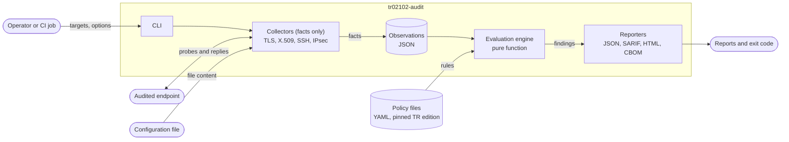
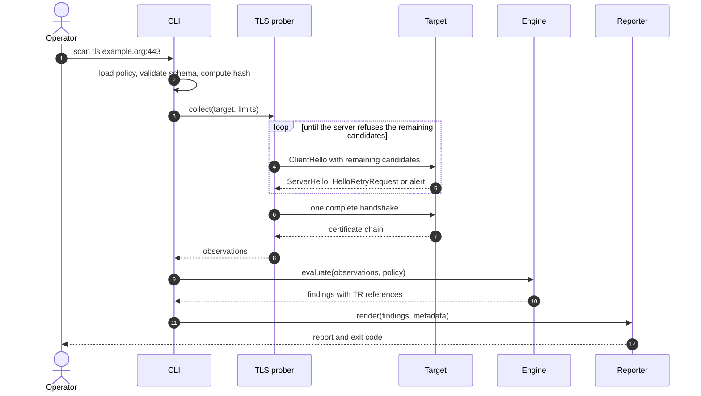

# Architecture

> Status: living document · Covers milestones M0–M5 · Last updated: 2026-11-13

## 1. Purpose

`tr02102-audit` checks whether the cryptographic configuration of network services follows BSI Technical Guideline TR-02102, "Cryptographic Mechanisms: Recommendations and Key Lengths".

For each audited endpoint it answers one question: which cryptographic parameters does this service actually accept, and which of them fall outside what the pinned TR-02102 edition recommends?

| Collector | What it inspects | Evaluated against | Milestone |
|---|---|---|---|
| TLS prober | Protocol versions, cipher suites, key-exchange groups | TR-02102-2 | M1 |
| X.509 analyser | Key type and size, signature algorithm, validity | TR-02102-1, TR-02102-2 | M1 |
| SSH prober | Key exchange, host keys, ciphers, MACs | TR-02102-4 | M3 |
| IPsec config parser | IKEv2 and ESP proposals in strongSwan configuration | TR-02102-3 | M4 |

### Non-goals

- No exploitation and no implementation-bug checks (Heartbleed, ROBOT and similar). General-purpose scanners cover those.
- No host or port discovery. The tool audits only the endpoints the operator names.
- No statement of formal compliance. The output is technical evidence for an auditor, not a certificate.

## 2. Design principles

| ID | Principle | Consequence in the design |
|---|---|---|
| P1 | Every finding is traceable | Each rule carries the TR part, edition and section it was transcribed from. |
| P2 | Facts are separate from judgment | Collectors record what an endpoint does. Only the engine decides whether that is acceptable. |
| P3 | Policy is data, not code | A TR edition is a set of declarative YAML files. Supporting a new edition means adding files, not changing code. |
| P4 | Results are reproducible | The engine is a pure function. Stored observations can be re-evaluated offline against any edition. |
| P5 | Inconclusive is never "pass" | Every check ends as `pass`, `fail`, `warn` or `inconclusive`. Network errors never turn into a clean result. |
| P6 | Safe by default | Bounded, low-rate traffic. All data received from a target is treated as hostile input. |
| P7 | Built for automation | Stable exit codes and machine-readable reports (JSON, SARIF) so the tool can gate a CI pipeline. |

## 3. Component view



The X.509 analyser does not open its own connection: it receives the certificate chain that the TLS prober fetched.

| Component | Responsibility | Must not do |
|---|---|---|
| CLI | Parse arguments, load and validate the policy, orchestrate a scan, set the exit code | Contain protocol or policy logic |
| Collectors | Talk to one protocol or parse one file format and emit normalised observations | Judge whether a value is good or bad |
| Observation store | Persist observations as JSON so a scan can be re-evaluated later | Hold findings |
| Policy loader | Load YAML with a safe loader, validate it against a JSON Schema, compute its SHA-256 | Execute anything found in a policy file |
| Evaluation engine | Map observations and rules to findings | Perform I/O or network access |
| Reporters | Render findings; escape every value that originated from a target | Change a finding |

## 4. Data model

Three record types flow through the tool. Field names below are the contract between components.

**Observation** – a fact, with no verdict attached:

```json
{
  "target": { "host": "example.org", "port": 443, "resolved_ip": "203.0.113.10", "sni": "example.org" },
  "collector": "tls",
  "collected_at": "2026-11-13T11:40:00Z",
  "facts": {
    "protocol_versions": ["TLS1.2", "TLS1.3"],
    "cipher_suites": {
      "TLS1.3": ["TLS_AES_256_GCM_SHA384"],
      "TLS1.2": ["TLS_ECDHE_RSA_WITH_AES_128_GCM_SHA256"]
    },
    "named_groups": ["secp256r1", "x25519"]
  },
  "inconclusive": []
}
```

**Rule** – one recommendation from the TR, as data. The example shows the schema; rule content, section numbers and validity periods are transcribed from the official TR text in milestone M1 and reviewed rule by rule.

```yaml
edition: "2026-01"
document: "BSI TR-02102-2"
rules:
  - id: TLS-PROTO-001
    title: Legacy protocol versions are not offered
    reference:
      section: "<transcribed from the pinned edition>"
    subject: tls.protocol_versions
    condition:
      none_of: ["SSL2.0", "SSL3.0", "TLS1.0", "TLS1.1"]
    severity: high
```

Conditions use a small fixed set of operators (`all_of`, `any_of`, `none_of`, `subset_of`, `min_value`). There is no expression language and no templating in policy files.

**Finding** – the result of applying one rule to one observation:

```json
{
  "rule_id": "TLS-PROTO-001",
  "status": "fail",
  "severity": "high",
  "evidence": { "offending_values": ["TLS1.0"] },
  "reference": { "document": "BSI TR-02102-2", "edition": "2026-01", "section": "..." },
  "target": { "host": "example.org", "port": 443 }
}
```

## 5. Scan sequence (TLS)



## 6. How TLS probing works

The prober builds ClientHello messages itself instead of relying on a TLS library, because a library only offers what its own build supports and hides what the server would have accepted.

- **Enumeration by elimination.** For each protocol version the prober offers all remaining candidate cipher suites. The server picks one; the prober records it, removes it from the list and repeats until the server refuses. The same method enumerates key-exchange groups. The number of connections is about the number of supported values plus one.
- **No cryptography needed for enumeration.** The server's choice arrives in ServerHello (or HelloRetryRequest), which is sent in cleartext in every TLS version. The prober reads that reply and closes the connection.
- **Key-exchange details in TLS 1.2** (curve, DH group size) are read from ServerKeyExchange, also cleartext.
- **Certificates.** TLS 1.3 encrypts the Certificate message, so the chain is fetched with one complete handshake through the standard library, with validation disabled on purpose: the collector retrieves, the engine judges.
- **Three outcomes per probe:** accepted, refused (clean alert), or inconclusive (timeout, reset, malformed reply). Inconclusive probes are listed in the observation and surface in the report (P5).
- **Post-quantum readiness.** The prober also reports whether the endpoint accepts a hybrid key-exchange group such as X25519MLKEM768. This is shown as a separate, informational section and is not mixed into the conformance verdict.

## 7. Outputs and exit codes

| Format | Consumer |
|---|---|
| JSON | Scripts, archival, later re-evaluation |
| SARIF 2.1.0 | GitHub code scanning and other CI dashboards |
| HTML | Human-readable audit evidence, single self-contained file without scripts |
| CycloneDX CBOM | Cryptographic inventory (M5) |

Every report embeds: tool version, policy edition and SHA-256, UTC timestamp, target, resolved IP, and the options used.

| Exit code | Meaning |
|---|---|
| 0 | No finding at or above the configured severity threshold |
| 1 | At least one finding at or above the threshold |
| 2 | Scan error or inconclusive result; the outcome must not be read as "pass" |

## 8. Technology choices

| Concern | Choice | Reason | Since |
|---|---|---|---|
| Language | Python 3.13 | Memory-safe, strong typing support, mature security libraries. See [ADR-0001](adr/0001-python-as-implementation-language.md). | M0 |
| CLI | `argparse` (standard library) | No extra dependency for a small command set | M0 |
| Tests | pytest, Docker Compose lab | Unit tests, and end-to-end tests against servers with a known configuration | M0 |
| Quality gates | Ruff (including its bandit rules), mypy in strict mode, pip-audit | Lint, types and dependency audit in CI | M0 |
| CI hygiene | Actions pinned by commit hash, read-only workflow token, Dependabot | Small supply-chain surface (threat T-04) | M0 |
| Models | Pydantic v2 | Validation at every component boundary | M1 |
| X.509 parsing | `cryptography` | Maintained, memory-safe parser | M1 |
| Policy | YAML via `yaml.safe_load` + JSON Schema | Readable in review, cannot carry code | M1 |
| Parser tests | Hypothesis | Property-based tests for everything that parses untrusted input | M1 |
| HTML report | Jinja2 with autoescape | Output encoding by default | M2 |
| Delivery | Container image, non-root, read-only filesystem | Reproducible run, small blast radius | M2 |

The package has no runtime dependencies in M0. Each library above is added together with the component that needs it, and from that point all dependencies are pinned in a hash-locked requirements file.

## 9. Repository layout

```text
tr02102-audit/
├── src/tr02102_audit/
│   ├── cli.py
│   ├── models.py            # Observation, Rule, Finding
│   ├── collectors/          # tls/, x509.py, ssh.py, ipsec.py
│   ├── policy/              # loader, JSON Schema
│   ├── engine.py
│   └── reporters/           # json, sarif, html, cbom
├── policies/2026-01/        # one YAML file per TR part
├── lab/                     # docker-compose.yml and known-bad targets
├── tests/                   # unit/, integration/
├── docs/                    # ARCHITECTURE.md, THREAT_MODEL.md, adr/
└── .github/workflows/
```

## 10. Milestones

| Milestone | Scope | Done when |
|---|---|---|
| M0 | Repository skeleton, CI, lab with two TLS targets (one good, one deliberately weak) | CI is green, including the lab smoke test |
| M1 | TLS prober, X.509 analyser, TR-02102-2 policy, JSON report | The weak lab target fails the expected rules, the good one passes |
| M2 | SARIF and HTML reports, container image, example GitHub Actions workflow | Findings appear in GitHub code scanning |
| M3 | SSH prober, TR-02102-4 policy | Lab OpenSSH targets produce the expected findings |
| M4 | strongSwan configuration parser, TR-02102-3 policy | Sample configurations produce the expected findings; no secret appears in any output |
| M5 | CycloneDX CBOM, post-quantum readiness section | CBOM validates against the CycloneDX schema |

## 11. Related work

The niche is not empty. This project is deliberately small and does not claim to replace the tools below.

| Tool | What it does | Relation to this project |
|---|---|---|
| [TLSAssistant](https://github.com/stfbk/tlsassistant) | TLS analysis framework; its compliance module compares a configuration against several guidelines, including BSI TR-02102-2 | Closest prior art for the TLS part |
| [Greenbone / OpenVAS](https://www.greenbone.net/en/blog/bsi-standards-tls-ssh-tr03116-4-tr02102-4/) | Compliance policies for BSI TR-03116-4 (TLS) and TR-02102-4 (SSH) inside a full vulnerability scanner | Same goal for SSH, much larger platform |
| [BSI TaSK](https://github.com/BSI-Bund/TaSK/) | TLS conformance testing based on TR-03116-TS | Tests implementations against a different guideline |
| testssl.sh, sslyze | General-purpose TLS scanners | Used as reference scanners in lab tests to cross-check the prober |

What this project adds: one lightweight tool for TLS, SSH, IPsec and X.509 under a single guideline family; policy as versioned data with a reference on every rule; stored observations that can be re-evaluated when a new edition appears; CI-native output.

## 12. Decisions

| Decision | Outcome | Alternative considered | Record |
|---|---|---|---|
| Implementation language | Python 3.13 | Go (single static binary) | [ADR-0001](adr/0001-python-as-implementation-language.md) |
| Licence | Apache-2.0 | EUPL-1.2 (common in European public-sector projects) | [LICENSE](../LICENSE) |

## References

- BSI TR-02102, all parts: <https://www.bsi.bund.de/dok/TR-02102-en>. The German originals take precedence over the English courtesy translations, so rules are transcribed from the German text.
- Threat model: [THREAT_MODEL.md](THREAT_MODEL.md)
