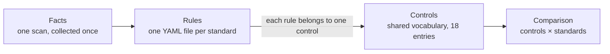

# Standards: how they are modelled and how to add one

A standard is a YAML file in [`src/tr02102_audit/standards/`](../src/tr02102_audit/standards/). The engine loads every file in that directory; adding a standard needs no code change.

## Why this scales

Three layers keep the work per standard small:



- **Facts** are collected once per scan and do not depend on any standard. A new standard reuses all of them.
- **Controls** (`protocol-versions`, `certificate-key`, …) are the shared vocabulary. Because every rule names its control, the report can put any number of standards side by side and show where they disagree, or where one of them says nothing at all.
- **Rules** are data: a subject (a path in the fact tree), an operator, and values. Eleven operators cover everything the current standards need.
- **Levels** come from the document: what it requires and what it only recommends are kept apart (next section).

## Rule format

```yaml
- id: BSI-TLS-07                       # unique within the file
  control: key-exchange-groups         # one of the controls in standards/__init__.py
  title: TLS 1.2 key-exchange groups are recommended ones
  severity: medium                     # high | medium | low | info
  on_violation: warn                   # the document says SHOULD: a warning, not a failure
  reference: "TR-02102-2, sec. 3.3.2, Table 6"
  when:                                # optional: otherwise "not applicable"
    subject: tls.protocol_versions
    op: contains
    value: TLS1.2
  check:
    subject: tls.groups.tls12
    op: subset_of
    values:
      - {value: secp256r1, until: 2031}   # "use up to" year, as in the BSI tables
      - {value: ffdhe3072, until: 2029}
  remediation: Limit the groups to NIST P-256/384/521 or Brainpool curves.
```

`until` models the "Verwendung bis" column of the BSI tables. In the final year a value is reported as a warning, and after it as a failure, without editing the file.

`phase_out: true` on a value models rating scales such as NCSC-NL's "To be phased out": the value is accepted with a warning. For certificate keys, `recommended_bits` does the same (for example RSA 2048 accepted, but below 3072 reported as a warning).

Operators: `subset_of`, `none_of`, `one_of`, `contains`, `empty`, `not_empty`, `present`, `is`, `min`, `max`, `key_strength`.

## Requirement levels

A standard chooses its words. RFC 9325 says "MUST NOT negotiate TLS 1.0" and "SHOULD support TLS 1.3"; treating both as failures would turn advice into a verdict the document never gave. So every rule carries the level of the sentence it was transcribed from:

| In the document | In the rule file | Finding when violated | Level in the report |
|---|---|---|---|
| MUST, MUST NOT, shall, "Insufficient" | default | `fail` | required |
| SHOULD, SHOULD NOT, "recommended", "To be phased out" | `on_violation: warn`, or `phase_out: true` on a value | `warn` | recommended |

A standard's verdict follows from that: one `fail` means "does not conform", only warnings mean "conforms, with warnings". When something the standard has a rule for could not be measured, the verdict is "incomplete", never a pass.

Some standards are approved lists: BSI TR-02102-2 and NIST SP 800-52r2 accept only what they name. A value that is absent from such a list is not thereby weak. When a rule about cipher suites or key-exchange groups objects only to sound values (AEAD cipher suites with forward secrecy, or a known group such as `x25519`), the report marks the finding "approved list only". A standard that fails for no other reason is marked the same way.

## File header

```yaml
id: pci-dss-4.0.1
title: "PCI DSS v4.0.1, Requirement 4.2.1: strong cryptography for data in transit"
short_name: PCI DSS 4.0.1
publisher: PCI Security Standards Council
edition: "2024-06"
url: https://www.pcisecuritystandards.org/document_library/
region: International (payment cards)
category: international      # government | international | community
default: true                # false: evaluated only when asked for
transcription: verified      # draft until every rule was checked against the document
```

`category` groups the standards in the interface: government and regulatory, international and industry standards, community baselines. The Mozilla profiles are widely used configuration advice, not formal standards, so they are in the last group and have `default: false`.

## The rating

The grade from A+ to F in every report is not part of any standard. It is defined in [`rating.yaml`](../src/tr02102_audit/rating.yaml) with the same rule format and evaluated by the same engine: a list of checks, each capping the grade at F, C or B when it does not hold, and one bonus check (hybrid post-quantum key exchange) that turns an A into an A+. It uses only points on which the standards here agree, such as "no SSL 3.0", "no RC4", "certificate trusted". A report that is incomplete gets no grade.

## Adding a standard

1. Copy an existing file and change `id`, `title`, `publisher`, `edition`, `url`.
2. Transcribe each requirement as a rule. Cite the exact section or table in `reference`.
3. Keep `transcription: draft` until every rule has been checked against the official document by a second person, then set it to `verified` in a separate pull request.
4. Add a test in `tests/test_engine.py` for at least one place where the new standard disagrees with an existing one.
5. Changes under `standards/` require review by the code owner (see `.github/CODEOWNERS`).

## Current standards

| File | Standard | Kind | Edition | Rules | Status |
|---|---|---|---|---|---|
| `bsi-tr-02102-2.yaml` | BSI TR-02102-2 (TLS) | Government, Germany | 2026-01 | 18 | draft |
| `nist-sp-800-52r2.yaml` | NIST SP 800-52 Rev. 2, government-only servers | Government, USA | 2019-08 | 18 | verified |
| `ncsc-nl-tls-2025.yaml` | NCSC-NL TLS Security Guidelines | Government, Netherlands | 2025-05 | 15 | draft |
| `ietf-rfc9325.yaml` | IETF RFC 9325 / BCP 195 | International | 2022-11 | 16 | verified |
| `pci-dss-4.0.1.yaml` | PCI DSS v4.0.1, requirement 4.2.1 | International, payment cards | 2024-06 | 10 | verified |
| `mozilla-intermediate.yaml` | Mozilla Server Side TLS, Intermediate | Community, optional | 5.7 | 13 | draft |
| `mozilla-modern.yaml` | Mozilla Server Side TLS, Modern | Community, optional | 5.7 | 9 | draft |

**Verification notes.**

- *IETF RFC 9325* and *NIST SP 800-52r2* were transcribed from the published text. For NIST, the list of approved key-exchange groups follows SP 800-56A Rev. 3, Appendix D, which section 3.4.2.2 refers to. The RSA key-transport cipher suites of Appendix D are accepted with a warning, as the appendix tolerates them for a transition period. NIST opened a review of SP 800-52r2 in May 2026; a revision may follow.
- *PCI DSS v4.0.1* names no cipher suites. The profile applies what the PCI Security Standards Council defines as strong cryptography (requirement 4.2.1, the glossary entry "Strong Cryptography", FAQ 1491). It is a technical pre-check; only a QSA or an ASV scan can attest compliance, and certificate revocation is not checked.
- *NCSC-NL 2025-05*: some per-row levels in Tables 1, 3 and 9 were not legible in the extracted PDF text and were inferred from the stated security-strength thresholds and Appendix A. The scale maps as follows: Insufficient = fail, To be phased out = warn, Sufficient and Good = pass.
- *BSI TR-02102-2*: the PDF could not be downloaded in the build environment. Values confirmed against indexed excerpts of the published document: the Table 1 entry `TLS_ECDHE_ECDSA_WITH_AES_128_GCM_SHA256` (2031), the static-ECDH Table 2 entries (2026), the TLS 1.2 groups in Table 6 including `ffdhe3072`/`ffdhe4096` (2029), and the TLS 1.3 groups including the `brainpool*tls13` codes (2031). The remaining Table 1 entries and the section numbers need a line-by-line review.
- *Mozilla 5.7*: protocols, cipher lists, curves and certificate types were checked against the guideline; the certificate-lifetime limit was not.

## Where the standards disagree

One measurement, judged by each standard: the "typical modern website" of the lab (TLS 1.2 and 1.3, ECDHE with AES-GCM and ChaCha20, X25519 and NIST curves, an RSA 2048 certificate). Its rating is A. A dash means the standard has no rule for the topic. The lab scan in CI asserts the rating and the verdicts of BSI, NIST, IETF and PCI DSS.

| Topic | BSI | NIST | IETF | NCSC-NL | PCI DSS | Mozilla Int. |
|---|---|---|---|---|---|---|
| TLS 1.2 suites: ChaCha20-Poly1305 is offered | fail, approved list only | fail, approved list only | warn | pass | — | pass |
| TLS 1.3 suites: `TLS_CHACHA20_POLY1305_SHA256` is offered | fail, approved list only | fail, approved list only | — | pass | — | pass |
| Key exchange: `x25519` is offered | warn | warn | — | pass | — | pass |
| Certificate key: RSA 2048 bit | fail (3000 bit minimum) | pass | pass | warn (to be phased out) | warn | pass |
| No hybrid post-quantum key exchange | warn | — | — | warn | warn | — |
| **Verdict** | does not conform | does not conform | conforms, 1 warning | conforms, 2 warnings | conforms, 2 warnings | conforms |

## Candidates for the next standards

| Standard | Why it matters | Effort |
|---|---|---|
| BSI TR-03116-4 / BSI Mindeststandard TLS | Binding for German federal agencies; stricter than TR-02102-2 | Low: same structure as TR-02102-2 |
| ANSSI "Recommandations de sécurité relatives à TLS" (France) | French national guideline | Low; the official PDF was not reachable from the build environment |
| Canadian Centre for Cyber Security ITSP.40.062 (2025) | Recent national guideline with recommended / sufficient / phase-out levels | Low |
| BSI TR-02102-4 (SSH) | Same guideline family; needs the SSH collector (milestone M3) | New collector + rules |
| BSI TR-02102-3 (IPsec) | Needs the strongSwan parser (milestone M4) | New collector + rules |
