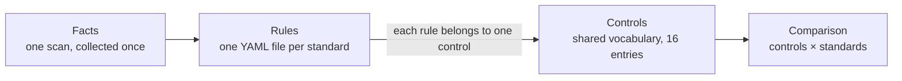

# Standards: how they are modelled and how to add one

A standard is a YAML file in [`src/tr02102_audit/standards/`](../src/tr02102_audit/standards/). The engine loads every file in that directory; adding a standard needs no code change.

## Why this scales

Three layers keep the work per standard small:



- **Facts** are collected once per scan and do not depend on any standard. A new standard reuses all of them.
- **Controls** (`protocol-versions`, `certificate-key`, …) are the shared vocabulary. Because every rule names its control, the report can put any number of standards side by side and show where they disagree, or where one of them says nothing at all.
- **Rules** are data: a subject (a path in the fact tree), an operator, and values. Eleven operators cover everything the current standards need.

## Rule format

```yaml
- id: BSI-TLS-07                       # unique within the file
  control: key-exchange-groups         # one of the controls in standards/__init__.py
  title: TLS 1.2 key-exchange groups are recommended ones
  severity: medium                     # high | medium | low | info
  on_violation: warn                   # optional: report "warn" instead of "fail"
  reference: "TR-02102-2, sec. 3.3.2, Table 6"
  when:                                # optional: otherwise "not applicable"
    subject: tls.protocol_versions
    op: contains
    value: TLS1.2
  check:
    subject: tls.groups.tls12
    op: subset_of
    values:
      - {value: secp256r1, until: 2031}   # "use up to" year, as in the BSI tables
      - {value: ffdhe3072, until: 2029}
  remediation: Limit the groups to NIST P-256/384/521 or Brainpool curves.
```

`until` models the "Verwendung bis" column of the BSI tables. In the final year a value is reported as a warning, and after it as a failure, without editing the file.

Operators: `subset_of`, `none_of`, `one_of`, `contains`, `empty`, `not_empty`, `present`, `is`, `min`, `max`, `key_strength`.

## Adding a standard

1. Copy an existing file and change `id`, `title`, `publisher`, `edition`, `url`.
2. Transcribe each requirement as a rule. Cite the exact section or table in `reference`.
3. Keep `transcription: draft` until every rule has been checked against the official document by a second person, then set it to `verified` in a separate pull request.
4. Add a test in `tests/test_engine.py` for at least one place where the new standard disagrees with an existing one.
5. Changes under `standards/` require review by the code owner (see `.github/CODEOWNERS`).

## Current standards

| File | Standard | Edition | Status |
|---|---|---|---|
| `bsi-tr-02102-2.yaml` | BSI TR-02102-2 (TLS) | 2026-01 | draft |
| `mozilla-intermediate.yaml` | Mozilla Server Side TLS, Intermediate | 5.7 | draft |
| `mozilla-modern.yaml` | Mozilla Server Side TLS, Modern | 5.7 | draft |

**Why everything is still "draft".** The BSI tables were transcribed from the published document as indexed by search engines, because the PDF itself could not be downloaded in the build environment. Values confirmed against those excerpts: the Table 1 entry `TLS_ECDHE_ECDSA_WITH_AES_128_GCM_SHA256` (2031), the static-ECDH Table 2 entries (2026), the TLS 1.2 groups in Table 6 including `ffdhe3072`/`ffdhe4096` (2029), and the TLS 1.3 groups including the `brainpool*tls13` codes (2031). The remaining Table 1 entries, the section numbers, and the Mozilla certificate-lifetime limit come from the author's knowledge of earlier editions and need a line-by-line review.

## Candidates for the next standards

| Standard | Why it matters | Effort |
|---|---|---|
| BSI TR-03116-4 / BSI Mindeststandard TLS | Binding for German federal agencies; stricter than TR-02102-2 | Low: same structure as TR-02102-2 |
| NIST SP 800-52 Rev. 2 | US federal baseline; common in international tenders | Low |
| PCI DSS v4.0, requirement 4.2.1 | "Strong cryptography" for cardholder data | Low, few rules |
| BSI TR-02102-4 (SSH) | Same guideline family; needs the SSH collector (milestone M3) | New collector + rules |
| BSI TR-02102-3 (IPsec) | Needs the strongSwan parser (milestone M4) | New collector + rules |
