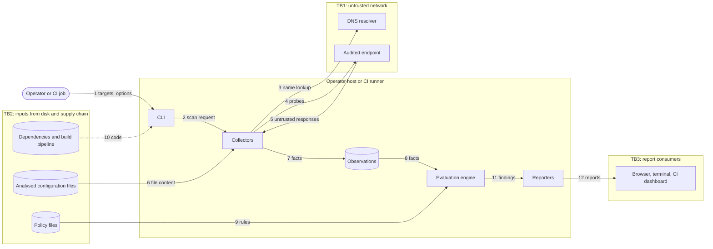

# Threat Model

> Method: STRIDE on a data-flow diagram · Scope: the tool, the machine it runs on, its inputs and its outputs · Status: living document, revisited at every milestone · Last updated: 2026-11-13

An audit tool is a security-relevant system in its own right. It parses data sent by servers it does not control, and people act on what it reports. This document lists what can go wrong and how the design in [ARCHITECTURE.md](ARCHITECTURE.md) responds.

## 1. Assets

| ID | Asset | Why it matters |
|---|---|---|
| A1 | Correctness of findings | A false "pass" lets a weak configuration through an audit. This is the primary asset. |
| A2 | Policy files | They encode the guideline. A silent change alters every result. |
| A3 | Operator host or CI runner | The tool parses hostile network input on this machine. |
| A4 | Reports and stored observations | They list the weaknesses of the audited infrastructure. |
| A5 | Availability of audited targets | An audit must not degrade the service it inspects. |
| A6 | Secrets in analysed configuration files | IPsec configuration may contain pre-shared keys (M4). |

## 2. Assumptions

- The operator is authorised to audit the named targets.
- The operator host is not already compromised.
- The network between the tool and a target is untrusted.
- A target may be misconfigured, compromised or actively hostile.
- Reports are opened in browsers, terminals and CI dashboards by people other than the operator.

## 3. Data-flow diagram

## 4. Trust boundaries

| ID | Boundary | What crosses it | Stance |
|---|---|---|---|
| TB1 | Tool ↔ network | DNS answers, handshake replies, certificates, SSH banners | Everything received is hostile input: length-checked, size-capped, time-boxed. |
| TB2 | Tool ↔ files and supply chain | Policy files, analysed configuration, dependencies, CI actions | Validated before use; integrity is recorded or pinned. |
| TB3 | Tool ↔ report consumers | Strings that originated from targets, embedded in reports | Encoded for the output format; never trusted because "we generated it". |

## 5. STRIDE analysis

Risk is a qualitative rating (likelihood × impact) before mitigation: H = high, M = medium, L = low.

| ID | Category | Threat | Asset | Risk | Mitigation | Verified by | From |
|---|---|---|---|---|---|---|---|
| T-01 | Spoofing | The audited endpoint is not the intended one: spoofed DNS answer, wrong virtual host, or a TLS-terminating middlebox in the path | A1 | M | Report records resolved IP, port, SNI and leaf-certificate fingerprint; `--resolve` pins the address; limitation documented | Integration test asserts the metadata | M1 |
| T-02 | Spoofing | A target shows the scanner a stricter configuration than it shows regular clients, or drops probes so weak options look unsupported | A1 | M | Three-state probe result; `inconclusive` is reported and sets exit code 2; residual risk documented | Unit tests with simulated resets and timeouts | M1 |
| T-03 | Tampering | A policy file is weakened by a malicious change or a local edit | A1, A2 | H | JSON Schema validation; policy edition and SHA-256 embedded in every report; mandatory review of `policies/` via CODEOWNERS; every rule cites its TR section | Golden tests fail when a verdict on a lab target changes | M1 |
| T-04 | Tampering | A dependency, a GitHub Action or the release pipeline is compromised | A1, A3 | H | No runtime dependencies in M0 and a hash-locked requirements file from the first one (M1); actions pinned by commit hash; read-only workflow token; Dependabot; dependency audit in CI; signed release artefacts with SBOM once releases exist | CI workflows; release checklist | M0 |
| T-05 | Tampering | Stored observations or a report are altered after the scan | A1 | M | Report embeds a digest of the observations it was built from; optional signing of reports in CI | Unit test recomputes the digest | M2 |
| T-06 | Repudiation | Nobody can show what was scanned, when, and with which tool and policy version | A1 | M | Report metadata (UTC time, tool version, policy edition and hash, options, target, resolved IP); structured JSON log; deterministic re-evaluation of stored observations | Re-evaluation test reproduces identical findings | M1 |
| T-07 | Information disclosure | Reports or observations reach unauthorised readers | A4 | M | No telemetry and no network traffic except to named targets; output files created with owner-only permissions; guidance on CI artefact retention | Test checks file mode; egress checked in the lab | M1 |
| T-08 | Information disclosure | Pre-shared keys from analysed configuration leak into observations, reports or logs | A6 | H | Parser extracts an allow-list of cryptographic parameters only, never copies raw lines, skips secret sections | Canary-secret test asserts absence from every output | M4 |
| T-09 | Denial of service | Probing overloads a fragile target or triggers lockouts and alerts | A5 | M | Sequential connections by default, documented upper bound per target, configurable delay, back-off on resets | Lab test counts connections against the bound | M1 |
| T-10 | Denial of service | A hostile server stalls or floods the tool: tarpit, oversized records, endless certificate chain | A3 | M | Connect and read timeouts, per-target deadline, hard caps on record size, message size and chain length | Tests against a malicious test server | M1 |
| T-11 | Elevation of privilege | A malformed protocol message crashes or subverts a parser | A3 | M | Memory-safe language; strict length-checked parsers that stop at the first inconsistency; no external binaries invoked with target-derived data; container runs non-root, read-only, without capabilities | Property-based parser tests | M1 |
| T-12 | Elevation of privilege | A policy file executes code through unsafe deserialisation or expression evaluation | A3 | H | Safe YAML loader; fixed set of declarative operators; no `eval`, no templating | Test loads a policy with a code-execution payload and expects rejection | M1 |
| T-13 | Elevation of privilege | Target-controlled strings (certificate subject, SSH banner) inject script into the HTML report or escape sequences into the terminal | A3, A4 | H | Target-derived values are tainted end to end; HTML autoescape and a script-free report with a restrictive Content-Security-Policy; control characters neutralised in terminal and log output; reports built by serialisers, never by string concatenation | Tests with a hostile certificate subject and banner | M2 |

### Web interface (added with the hosted deployment)

The web service adds a new trust boundary, TB4: browsers on the Internet ↔ the hosted service. A hosted scanner is an attractive tool to misuse, so these threats get the strictest treatment.

| ID | Category | Threat | Asset | Risk | Mitigation | Verified by |
|---|---|---|---|---|---|---|
| T-14 | Elevation of privilege | Server-side request forgery: a user makes the service probe internal addresses (cloud metadata at 169.254.169.254, the hosting provider's private network, localhost) | A3 | H | Every resolved address must be public (`ipaddress.is_global`, IPv4-mapped IPv6 unwrapped); the host is resolved once and all probes connect to that pinned IP, so DNS rebinding between check and use has no effect | `tests/test_netguard.py`, `tests/test_web.py::test_private_targets_are_refused` |
| T-15 | Spoofing | Password guessing against the login | A3, A5 | M | Constant-time comparison; 10 attempts per IP per 15 minutes; without `APP_PASSWORD` the instance is demo-only | `test_wrong_password_is_refused_and_rate_limited` |
| T-16 | Tampering | Cross-site request forgery: another site makes a signed-in browser start scans | A5 | M | Per-session CSRF token on every POST; `SameSite=Lax`, `HttpOnly`, `Secure` session cookie | `test_post_without_csrf_token_is_rejected` |
| T-17 | Denial of service | Many scans exhaust the free-tier instance or turn it into a load generator | A5 | M | Two scan workers, at most six queued scans, 10 scans per session per hour, per-scan connection and time budget (T-09) | Unit tests of the limiter; job queue bound |
| T-18 | Information disclosure | Reports of one user are seen by others, or survive longer than needed | A4 | L | Report URLs carry 96-bit random identifiers and require login; reports are kept in memory only, at most 50, and vanish on restart | Code review |
| T-19 | Spoofing | Open redirect after login sends the user to a phishing page | A3 | L | Only same-site relative paths are accepted as `next` | `test_open_redirect_after_login_is_blocked` |

Response headers on every page: a Content-Security-Policy with `default-src 'none'` (the site uses no JavaScript at all), `X-Frame-Options: DENY`, `Referrer-Policy: no-referrer`, `nosniff`, and HSTS over HTTPS.

## 6. Abuse case: unauthorised scanning

The tool could be pointed at systems the operator has no right to test. It is designed to be a poor fit for that: it has no discovery features, accepts only explicitly named endpoints, sends a small bounded number of ordinary handshakes, and performs no exploitation. The hosted instance additionally requires a password, asks the user to confirm authorisation before every scan, refuses private addresses and rate-limits scans. The README and the CLI help state that it is for authorised use only.

## 7. Residual risks

| Risk | Why it remains | How it is handled |
|---|---|---|
| Black-box limits | Probing shows what one endpoint accepted at one moment. Backends behind a load balancer may differ, and absence of a weak option cannot be proven. | Stated in every report; `inconclusive` is explicit. |
| Transcription errors | Rules are transcribed from a PDF by a person. | Rule-by-rule review, section reference on every rule, cross-check against reference scanners in the lab. |
| Stale policy | TR-02102 is revised regularly. | The edition is shown prominently in every report; a new edition is a new policy directory. |

## 8. Review triggers

Revisit this document when a collector is added, when a new output format is added, when a dependency that parses untrusted input changes, or when a milestone closes.
