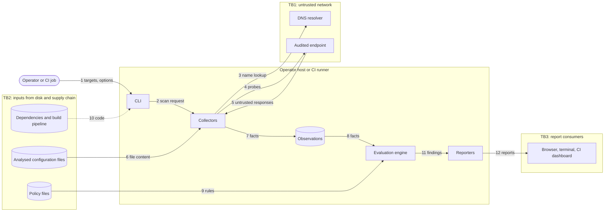

# Threat Model

> Method: STRIDE on a data-flow diagram · Scope: the tool, the machine it runs on, its inputs and its outputs · Status: living document, revisited at every milestone · Last updated: 2026-11-18

An audit tool is a security-relevant system in its own right. It parses data sent by servers it does not control, and people act on what it reports. This document lists what can go wrong and how the design in [ARCHITECTURE.md](ARCHITECTURE.md) responds.

## 1. Assets

| ID | Asset | Why it matters |
|---|---|---|
| A1 | Correctness of findings | A false "pass" lets a weak configuration through an audit. This is the primary asset. |
| A2 | Policy files | They encode the guideline. A silent change alters every result. |
| A3 | Operator host or CI runner | The tool parses hostile network input on this machine. |
| A4 | Reports and stored observations | They list the weaknesses of the audited infrastructure. |
| A5 | Availability of audited targets | An audit must not degrade the service it inspects. |
| A6 | Secrets in analysed configuration files | IPsec configuration may contain pre-shared keys (M4). |
| A7 | Accounts and the audit log of the hosted service | Password hashes, login names, and a record of who checked which address from where. Personal data. |

## 2. Assumptions

- The operator is authorised to audit the named targets.
- The operator host is not already compromised.
- The network between the tool and a target is untrusted.
- A target may be misconfigured, compromised or actively hostile.
- Reports are opened in browsers, terminals and CI dashboards by people other than the operator.

## 3. Data-flow diagram

## 4. Trust boundaries

| ID | Boundary | What crosses it | Stance |
|---|---|---|---|
| TB1 | Tool ↔ network | DNS answers, handshake replies, certificates, SSH banners | Everything received is hostile input: length-checked, size-capped, time-boxed. |
| TB2 | Tool ↔ files and supply chain | Policy files, analysed configuration, dependencies, CI actions | Validated before use; integrity is recorded or pinned. |
| TB3 | Tool ↔ report consumers | Strings that originated from targets, embedded in reports | Encoded for the output format; never trusted because "we generated it". |

## 5. STRIDE analysis

Risk is a qualitative rating (likelihood × impact) before mitigation: H = high, M = medium, L = low.

| ID | Category | Threat | Asset | Risk | Mitigation | Verified by | From |
|---|---|---|---|---|---|---|---|
| T-01 | Spoofing | The audited endpoint is not the intended one: spoofed DNS answer, wrong virtual host, or a TLS-terminating middlebox in the path | A1 | M | Report records resolved IP, port, SNI and leaf-certificate fingerprint; `--resolve` pins the address; limitation documented | Integration test asserts the metadata | M1 |
| T-02 | Spoofing | A target shows the scanner a stricter configuration than it shows regular clients, or drops probes so weak options look unsupported | A1 | M | Three-state probe result; `inconclusive` is reported and sets exit code 2; residual risk documented | Unit tests with simulated resets and timeouts | M1 |
| T-03 | Tampering | A policy file is weakened by a malicious change or a local edit | A1, A2 | H | JSON Schema validation; policy edition and SHA-256 embedded in every report; mandatory review of `policies/` via CODEOWNERS; every rule cites its TR section | Golden tests fail when a verdict on a lab target changes | M1 |
| T-04 | Tampering | A dependency, a GitHub Action or the release pipeline is compromised | A1, A3 | H | No runtime dependencies in M0 and a hash-locked requirements file from the first one (M1); actions pinned by commit hash; read-only workflow token; Dependabot; dependency audit in CI; signed release artefacts with SBOM once releases exist | CI workflows; release checklist | M0 |
| T-05 | Tampering | Stored observations or a report are altered after the scan | A1 | M | Report embeds a digest of the observations it was built from; optional signing of reports in CI | Unit test recomputes the digest | M2 |
| T-06 | Repudiation | Nobody can show what was scanned, when, and with which tool and policy version | A1 | M | Report metadata (UTC time, tool version, policy edition and hash, options, target, resolved IP); structured JSON log; deterministic re-evaluation of stored observations | Re-evaluation test reproduces identical findings | M1 |
| T-07 | Information disclosure | Reports or observations reach unauthorised readers | A4 | M | No telemetry and no network traffic except to named targets; output files created with owner-only permissions; guidance on CI artefact retention | Test checks file mode; egress checked in the lab | M1 |
| T-08 | Information disclosure | Pre-shared keys from analysed configuration leak into observations, reports or logs | A6 | H | Parser extracts an allow-list of cryptographic parameters only, never copies raw lines, skips secret sections | Canary-secret test asserts absence from every output | M4 |
| T-09 | Denial of service | Probing overloads a fragile target or triggers lockouts and alerts | A5 | M | Sequential connections by default, documented upper bound per target, configurable delay, back-off on resets | Lab test counts connections against the bound | M1 |
| T-10 | Denial of service | A hostile server stalls or floods the tool: tarpit, oversized records, endless certificate chain | A3 | M | Connect and read timeouts, per-target deadline, hard caps on record size, message size and chain length | Tests against a malicious test server | M1 |
| T-11 | Elevation of privilege | A malformed protocol message crashes or subverts a parser | A3 | M | Memory-safe language; strict length-checked parsers that stop at the first inconsistency; no external binaries invoked with target-derived data; container runs non-root, read-only, without capabilities | Property-based parser tests | M1 |
| T-12 | Elevation of privilege | A policy file executes code through unsafe deserialisation or expression evaluation | A3 | H | Safe YAML loader; fixed set of declarative operators; no `eval`, no templating | Test loads a policy with a code-execution payload and expects rejection | M1 |
| T-13 | Elevation of privilege | Target-controlled strings (certificate subject, SSH banner) inject script into the HTML report or escape sequences into the terminal | A3, A4 | H | Target-derived values are tainted end to end; HTML autoescape and a script-free report with a restrictive Content-Security-Policy; control characters neutralised in terminal and log output; reports built by serialisers, never by string concatenation | Tests with a hostile certificate subject and banner | M2 |

### Web interface (added with the hosted deployment)

The web service adds a new trust boundary, TB4: browsers on the Internet ↔ the hosted service, and with accounts a second one, TB5: the service ↔ its database. A hosted scanner is an attractive tool to misuse, so these threats get the strictest treatment.

| ID | Category | Threat | Asset | Risk | Mitigation | Verified by |
|---|---|---|---|---|---|---|
| T-14 | Elevation of privilege | Server-side request forgery: a user makes the service probe internal addresses (cloud metadata at 169.254.169.254, the hosting provider's private network, localhost) | A3 | H | Every resolved address must be public (`ipaddress.is_global`, IPv4-mapped IPv6 unwrapped); the host is resolved once and all probes connect to that pinned IP, so DNS rebinding between check and use has no effect. Refused targets are written to the audit log, because probing for private addresses is what an attack on the scanner looks like. A lab may name private networks that are allowed (`PRIVATE_NETWORKS`); everything outside them stays refused, and the hosted instance names none. | `tests/test_netguard.py`, `test_private_targets_are_refused_and_logged`, `test_lab_networks_can_be_allowed` |
| T-15 | Spoofing | Password guessing against the login | A7 | M | scrypt hashes (N=2^15, r=8, p=3, per-password salt); 10 failed attempts per address and 100 per login name in 15 minutes, checked before the password is. The number per login is higher on purpose: one address cannot lock an account for everybody else, while guessing from many addresses is still capped; a minimum length for new passwords; without `APP_PASSWORD` the instance has no account at all | `test_failed_sign_ins_are_rate_limited`, `test_one_address_cannot_lock_an_account_for_everybody`, `test_many_addresses_guessing_one_login_are_stopped`, `tests/test_security.py` |
| T-16 | Tampering | Cross-site request forgery: another site makes a signed-in browser start scans or change accounts | A5, A7 | M | A per-session token is checked on every POST in one place, before any view runs; `SameSite=Lax`, `HttpOnly`, `Secure` session cookie; state changes only happen on POST | `test_forms_without_a_valid_token_are_rejected` |
| T-17 | Denial of service | Many scans exhaust the instance or turn it into a load generator | A5 | M | Two scan workers and at most six jobs accepted at a time; 30 checks per account and hour; a monthly limit per account; per-scan connection and time budget (T-09) | `test_monthly_limit_applies_to_users_but_not_to_administrators`, `test_hourly_limit` |
| T-18 | Information disclosure | Reports of one account are seen by another, or are kept longer than needed | A4 | M | Every report and every saved server belongs to an account; a comparison opens only when both checks do. A foreign report answers exactly like one that does not exist (404), also for downloads and deletion. Report identifiers are 96 random bits. Reports are deleted after `REPORT_RETENTION_DAYS`, with the account, or by their owner. | `test_reports_belong_to_their_owner`, `test_servers_and_comparisons_belong_to_their_owner`, `test_old_audit_events_and_reports_are_deleted` |
| T-19 | Spoofing | Open redirect: a link to this site sends the user on to a phishing page, after login or through a link on an error page | A3 | L | `next` must be a path on this site made of plain path characters; tabs and newlines, which browsers drop from a URL, are refused. Language links are built from the matched route, never from the raw request path. | `test_redirect_after_sign_in_stays_on_this_site`, `test_language_links_never_point_to_another_site` |
| T-20 | Tampering | SQL injection through a login name, a search field or a target | A7, A4 | H | Every statement uses bound parameters. Column names in updates come from a fixed set in the code, never from a request. The same statements run on SQLite and PostgreSQL. | `test_request_text_is_data_never_sql`, `test_users_have_unique_logins_and_whitelisted_columns` |
| T-21 | Spoofing | A stolen or planted session cookie is used: session fixation, or a session that outlives a password change | A7 | M | Signing in starts a new session. The session carries a stamp derived from the password hash, so changing or replacing a password ends every other session; a blocked or deleted account loses its session at the next request. Sessions end after 12 hours. | `test_changing_the_password_signs_out_other_devices`, `test_administrator_creates_blocks_and_deletes_accounts` |
| T-22 | Information disclosure | The service reveals which accounts exist: a different answer or a faster answer for an unknown login name | A7 | L | The same message for a wrong password, an unknown login and a blocked account; for an unknown login a dummy hash is verified, so the answer takes as long. Open registration necessarily says when an address is taken; the number of such answers per address is limited. | `test_wrong_password_and_unknown_login_get_the_same_answer`, `test_registration_is_limited_per_address_and_refuses_duplicates` |
| T-23 | Denial of service | Password hashing is used to exhaust memory: many sign-in attempts at once, or a stored hash with absurd cost parameters | A3 | M | One scrypt hash needs 32 MiB; at most two run at a time. Cost parameters of a stored hash are checked against fixed bounds before use. Request bodies are capped at 256 KiB and passwords at 200 characters. | `test_malformed_or_hostile_hashes_never_verify` |
| T-24 | Elevation of privilege | A user reaches administration pages, or changes another account | A7 | H | Two roles; every administration view is behind one decorator that checks the role on the server for each request. The last administrator cannot be deleted, blocked or demoted, and nobody can do that to their own account by accident. | `test_users_cannot_open_the_administration`, `test_last_administrator_cannot_be_removed_blocked_or_demoted` |
| T-25 | Information disclosure | The audit log itself becomes the leak: IP addresses, login names, and passwords typed into the login field by mistake | A7 | M | Only administrators can read it. A login name nobody owns is cut to its first two characters before it is stored, plus a four-character keyed hash so that different names stay distinguishable (password spraying) without revealing them. Field lengths are capped. Events are deleted after `AUDIT_RETENTION_DAYS` (30 by default). The privacy page states what is recorded and why. | `test_wrong_password_and_unknown_login_get_the_same_answer`, `test_old_audit_events_and_reports_are_deleted`, `test_markup_in_logged_text_is_escaped` |
| T-26 | Repudiation | A client forges its address (`X-Forwarded-For`, `CF-Connecting-IP`) to poison the audit log or to slip under the rate limits | A7 | M | Proxy headers are ignored unless the operator states that a proxy sits in front (`TRUST_PROXY`) and which header carries the visitor's address (`CLIENT_IP_HEADER`); the value must parse as an IP address | `test_address_headers_are_ignored_unless_the_operator_trusts_them`, `test_visitor_address_comes_from_the_header_only_when_configured` |
| T-27 | Tampering | Formula injection through the CSV export: a login name or browser string such as `=HYPERLINK(...)` runs when an administrator opens the export in a spreadsheet | A7 | M | Cells that start with `=`, `+`, `-`, `@`, a tab or a carriage return are prefixed with an apostrophe, which makes them text; every export is itself written to the audit log | `test_audit_log_filters_and_csv_export` |
| T-28 | Tampering | Markup injection into the PDF: certificate fields or host names reach reportlab's paragraph markup | A4 | L | Every value from the scanned server is XML-escaped before it reaches a paragraph, as on the web page (T-13) | `test_hostile_server_fields_cannot_inject_markup` |

Response headers on every page: a Content-Security-Policy with `default-src 'none'` (the site uses no JavaScript at all), `X-Frame-Options: DENY`, `Referrer-Policy: no-referrer`, `nosniff`, `Cache-Control: no-store`, and HSTS over HTTPS.

## 6. Abuse case: unauthorised scanning

The tool could be pointed at systems the operator has no right to test. It is designed to be a poor fit for that: it has no discovery features, accepts only explicitly named endpoints, sends a small bounded number of ordinary handshakes, and performs no exploitation. The hosted instance additionally requires an account, keeps registration closed until an administrator opens it, asks the user to confirm authorisation before every check, refuses private addresses, limits checks per hour and per month, and records who checked which address from where. An administrator can block an account that misuses the service. The README and the CLI help state that it is for authorised use only.

## 7. Residual risks

| Risk | Why it remains | How it is handled |
|---|---|---|
| Black-box limits | Probing shows what one endpoint accepted at one moment. Backends behind a load balancer may differ, and absence of a weak option cannot be proven. | Stated in every report; `inconclusive` is explicit. |
| Transcription errors | Rules are transcribed from a PDF by a person. | Rule-by-rule review, section reference on every rule, cross-check against reference scanners in the lab. |
| Stale policy | TR-02102 is revised regularly. | The edition is shown prominently in every report; a new edition is a new policy directory. |
| Rate limits live in memory | The limits on sign-in attempts, registrations and hourly checks are counted in the one running process and start again after a restart. | The monthly limit is counted in the database. The service runs as a single process; several instances would need a shared counter. |
| No second factor | An account is protected by its password alone. | Rate limiting, long minimum length, session invalidation on password change; a second factor is a candidate for a later version. |
| Volatile storage on free hosting | Without a persistent disk or a database the audit log is lost on restart. | The administration page warns; `DATABASE_URL` switches to PostgreSQL. |

## 8. Review triggers

Revisit this document when a collector is added, when a new output format is added, when a dependency that parses untrusted input changes, when the web interface gains a way to change state (accounts, payments), or when a milestone closes.
